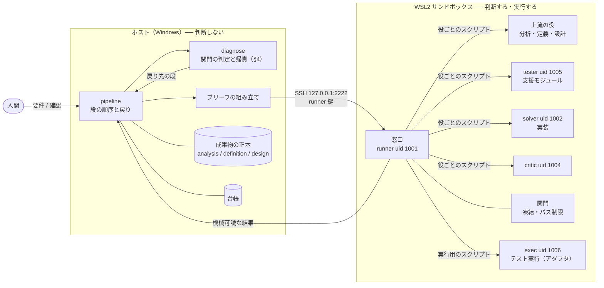
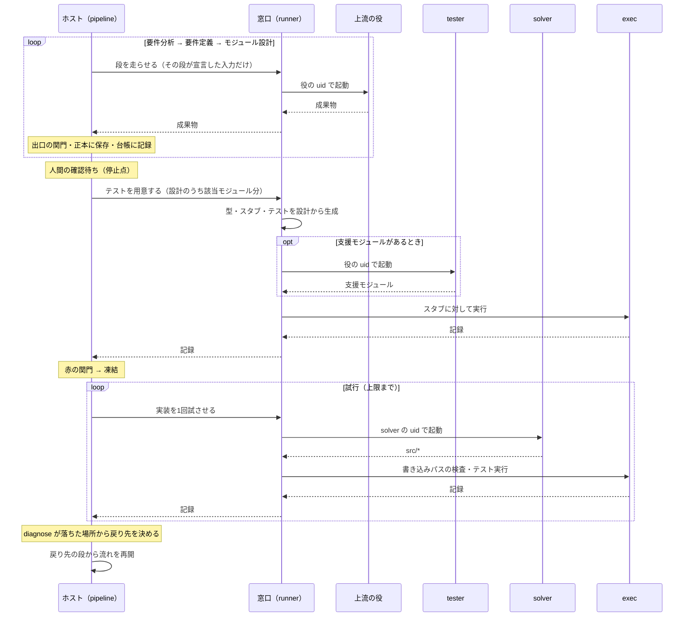

# REDESIGN.md — 定義と設計を深くして、実装を弱いモデルに任せる

> **状態: 設計中。** プロビジョン（§7）は 2026-10-09 に実装した。それ以外は未実装。決まったことは §10。
>
> 旧い形は [archive/ARCHITECTURE.md](archive/ARCHITECTURE.md)。この文書はそこから**何を変えるか**を述べる。
> 現状と合わない部分は、この文書に合わせて作り直す。

---

## 1. 目的と考え方

### 目的

**要件を入れると、開けばそのまま動くアプリを出力する。**

- 出力は**1つの HTML ファイル**。必要なものを全部埋め込み、ダブルクリックするとブラウザで開いて
  アプリの画面が出る。インストールは要らない
- **「終わった」とは、そのファイルを開くとアプリの画面が出て、定義の例どおりに動くこと。**
  機械が確かめるのは定義の例（組み立てのテスト）まで。見た目と操作感は人間が開いて確かめる
- アプリは**ブラウザのサンドボックスの中で動く**。生成されたコードがホストを直接触ることはない
  （箱の外で動く唯一の生成物なので、ここは譲らない）

プラットフォームは定義が宣言する。**まず ① と ② を目標にする:**

| | プラットフォーム | 画面 | 作れるもの |
|---|---|---|---|
| ① | `browser-dom` | DOM | 表示とボタンで遊ぶもの（放置ゲームなど） |
| ② | `browser-3d` | three.js（WebGL） | 3D で動かすもの（FPS など） |
| ③ | 静的サイト・Next.js ＋ デプロイ | ── | **後で**。デプロイはホストから、人間の確認のあとで、ホストの鍵で行う |

表現の幅はライブラリで決まる。solver も exec も外へ通信できないので、**ライブラリはプラットフォーム
ごとにプロビジョンで版を固定して入れ**、designer はその一覧から選ぶ。誰が何を持ち込んだかが常に分かる。

**アプリごとに書かれる、確かめられないコードを無くす。** ゲームのロジック（移動・当たり判定・得点・
カメラの計算）は純粋なモジュールにして例で確かめ、画面には「何をどこに描くか」という**画面の記述**
（データ）だけを渡す。記述を DOM や three.js に描く部分は、**プラットフォームごとに機械側が用意する
汎用のシェル**にする。放置ゲームの `view` が返す `View` は、すでにこの形になっている。

### 考え方

**定義と設計を部分的に、深く書く。そうすれば実装は狭い仕事になり、弱いモデルでも担える。**

- 要件を分析し、定義し、**モジュール単位まで**設計する
- 設計からテストを起こし、テストから実装する
- テストが落ちたら、**落ちた場所でどの段が悪いかが決まる**ように流れを組む（§4）
- 段から段への進行と戻りを、**人間ではなく機械がループとして回す**
- その機構は**サンドボックスの外**に置き、1つの流れとしてプログラムに書く。
  LLM と、生成されたコードの実行はサンドボックスの中に残す（§6）
- **言語を選ばない。** 言語ごとの差はアダプタに閉じ込める（§5）

実装は弱いモデルが行う。デバッグは、できる限り機械的に行う。

---

## 2. 流れ

```
要件分析 → 要件定義 → モジュール設計 → テスト作成 → 実装 → デバッグ
   ▲           ▲             ▲              ▲          ▲        │
   └───────────┴─────────────┴──────────────┴──────────┴────────┘
                  落ちた場所が、戻り先の段を指す（§4）
```

| 段 | 出力 | 担い手 | いま |
|---|---|---|---|
| 要件分析 | 分析結果 | 未決 | **無い**（人間が `REQUIREMENTS.md` を書く） |
| 要件定義 | 外部インターフェースと例 | 未決 | **無い**（同上） |
| モジュール設計 | モジュール・契約・依存・組み立て・例 | 未決 | **独立していない**（`tasks.json` が作る順序と一緒に暗黙に持つ） |
| テスト作成 | `tests/*` | **機械**（アダプタが設計の例から生成）。支援モジュールだけ Claude（tester uid） | ソルバー（9B）が書いている。run 8 の未解決の失敗3件は全部ここ |
| 実装 | `src/*` | **弱いモデル** | ある（IMPL） |
| デバッグ | 戻り先の判定 | **機械** | 一部（IMPL ⇄ VERIFY のリトライのみ。戻り先は常に実装） |
| 全体のループ | 状態・台帳 | **機械** | **無い**（次に打つ動詞を人間が覚えている） |

**各段の出力は機械が読める形にする。** §4 の関門は「設計が定義を含んでいるか」
「テストが設計の例を使っているか」を突き合わせるので、突き合わせる相手が散文だと検査できない。

---

## 3. なぜ深く設計するのか

### 弱いモデルは、狭い範囲なら実装できる

| | 結果 |
|---|---|
| run 6 | run 5 の計画をそのまま使い、ソルバーをローカルの 9B に替えた。**11/11 を全ステップ1回で緑** |
| run 8 | 9B が S1・S2・S4 の**実装を1回目で緑**（S1 は12テスト、S2 は17テスト） |
| run 8 S1 | RED_GATE を 12/12 で抜けたあと、**IMPL が文脈長で落ちた** |
| 新しい形・4回目（2026-10-10） | 放置ゲームの **8 モジュールすべてを 1 回目の試行で緑**（89 秒）。設計が `doc` を持ち、`format` を分けたあと（§10 再開点） |

最後の行は、範囲が広すぎれば弱いモデルは落ちることを示している。範囲を狭めることは
これに直接効く。

### 「深い」とは、判断を上流に寄せること

設計がシグネチャ、依存先、具体的な入出力の値まで決めていれば、実装は
**判断ではなく書き写し**になる。弱いモデルに残すのは書き写しだけにする。

### 組み立ても設計の一部にする

分割を細かくするほど、**モジュールの「間」にあるもの**が増える ── どれがどれを呼ぶか、
初期状態、起動経路。ここが誰の担当でもないと、部分は全部正しいのに全体が動かない。

- run 7: `production_rate` も `buy_generator` も `view` も正しかった。欠けていたのは
  「最初の資源を得る経路」で、**どのモジュールにも属していなかった**
- run 8 S1: `app.ts` は**作られ、テストされ、出荷物から呼ばれなかった**

だからモジュール設計は、モジュールの一覧だけでなく**組み立て**も1つの設計物として持つ。
組み立て自体も小さな実装単位（組み立てモジュール）として切り出し、弱いモデルの範囲に収める。
**組み立てモジュールのテストは、定義の例そのもの**である（§4）。

---

## 4. デバッグ ── 落ちた場所が、悪い段を指す

**テストが落ちた場所だけで、どの段が悪いかが決まるように作る。** 落ちたあとで推理するのでは
なく、各段の誤りが**その段に対応する場所でしか表に出ない**ように流れを組む。
判定は機械が行い、モデルに判断させない ── いまのランナーの関門と同じ原則である。

### いまの穴

いまは VERIFY が落ちると、戻り先は常に実装である。テストのほうが間違っていると止まらない。

> run 8 の S5 で、`return storage.getItem(KEY)` という**完全に正しい実装が6回書かれて
> 6回落ちた。** テストが自前で書いた偽 Storage が `data[key] || null` で、`""` を `null` に潰していたため。

run 8 の未解決の失敗3件（S3 期待値リテラルの `{}` 落ち、S4 存在しないマッチャ `deepEquals`、
S5 上記）は**どれもテスト側の誤り**で、どれも実装に戻され続けた。

### 落ちたあとに推理する表では足りない

前の版は「観測 → 判定」の10行の表で、落ちたあとに戻り先を推理していた。これを run 8 に当てると、
**S5 はどの行にも当たらず「分割し直す」へ誤送される。** 偽 Storage は例外を投げず、間違った値を
返すだけで、テストの期待値 `""` は設計とも一致しているからである。

**テストの中に、検証されていないロジックがある限り、観測で捉えられない誤りが残る。**
だから表を精密にするのではなく、誤りが入り込む余地を潰し、潰しきれないものは**その段の出口で**止める。

### 3つの仕掛け

1. **テストは誰にも書かせない。** 設計の例はデータ（呼ぶ関数・引数名つきの入力・期待値）なので、
   テストは「値を作り、呼び、1回だけ比べる」の書き写しにしかならない。**アダプタが例から生成する**
   （[FORMATS.md](FORMATS.md) §8-1）。期待値のリテラルも、テストフレームワークの API も誰も打たないので、
   S3 と S4 は構造的に起きない
2. **テストの中にロジックを置かない。** 偽物・ヘルパなど、判断を含むテスト側のコードは
   **支援モジュール**として設計に載せ、例を持たせ、使われる前にそれ自体の赤→緑を通す。
   支援モジュールの中身は tester（Claude）が書く。S5 の偽 Storage は
   「`setItem(k, "")` のあと `getItem(k)` は `""`」という例で、使われる前に落ちる
3. **整合は各段の出口で確かめる。** 定義と設計、設計とテストの突き合わせを、失敗のあとではなく
   次の段へ渡す前に行う。**凍結されてから見つかるテストの誤りを無くす**

### テストの形

アダプタが生成するテストは、どの言語でもこの形になる（擬似コード）。

```
ex = example("M2.E1")                            # 設計の例を読む（入力と期待値）
p  = current_cost(ex.arg(0, "spec"), ex.arg(0, "owned"))   # 段ごとに、引数名で値を作って呼ぶ
check(ex, [p])                                   # 観測する値を1回だけ比べる。期待値は ex が持つ
```

- `example` / `check` / `check_raises` は機械が言語ごとに配る（§5）
- 比較は言語に依らない正規形で行う。浮動小数の許容誤差は設計の例が持つ
- 比較関数は**記録**を残す ── `START M3.E2`、`CHECK M3.E2 pass|fail 期待値 実際の値`。
  **判定はテストフレームワークの報告ではなく、この記録から読む。** フレームワークは走らせ役にすぎず、
  言語ごとの報告形式の差はここで消える
- 入力は**引数名で**持ち、生成器が契約の引数の並びに当てはめる。同じ型の引数を取り違える余地も無い

### 関門と帰責

```
要件定義 ─────────────────────────────────────────── 人間のレビュー
 │ 出口: 定義の関門                                        ▲
 モジュール設計 ──────────────────── 組み立てモジュールの検証（定義の例）
 │ 出口: 設計の関門 → スタブ生成                     ▲
  テスト生成 ── 出口: 赤の関門（スタブに対して）→ 凍結 │
   実装 ─────── 検証（モジュールの例）───────────────┘
```

| 落ちた場所 | 何が起きたか | 悪い段 |
|---|---|---|
| **定義の関門** | 形式違反 / 例の無い定義項目 / 同じ入力に違う期待値 | 要件定義 |
| **設計の関門** | 形式違反 / 依存の循環・未解決 / 組み立てから到達できないモジュール / 例の無い関数 / 同じ入力に違う期待値 | モジュール設計 |
| | 定義の例が、組み立てモジュールの例として**そのまま**含まれていない | モジュール設計 |
| **スタブ生成** | 設計の関門を通った契約から、アダプタがビルドできるスタブを作れない | **エンジン**（人間） |
| **赤の関門** | 生成したテストがビルドできない / `START` が無い / 例が抜けている / `check` が1回でない | **エンジン**（テスト生成器） |
| | `START` のあと `CHECK` が無い（スタブに対して例外で落ちた） | **エンジン** ── テストもスタブも契約から機械が作るので、合わないのは機械の誤り |
| | 関数の結果を観測する例が、スタブに対して通ってしまう | **エンジン** ── 番兵は設計の全期待値と衝突しないよう機械が選ぶ |
| | 支援モジュールの例が、tester の書いた支援モジュールで緑にならない | テスト作成（tester） |
| **検証**（試行ごと） | 自分の例が落ちる / 例外 | 実装（もう一度） |
| | 前に緑だったテストが落ちる | 実装（もう一度） |
| | 設計で宣言していないモジュールを参照している | 実装（その試行は棄却して、もう一度） |
| **検証**（試行を使い切った） | 全試行が「宣言外の参照」 | モジュール設計（境界: 依存が足りない） |
| | 全試行が「前の緑を壊す」 | モジュール設計（境界: ぶつかっている） |
| | それ以外 | モジュール設計（粒度: 分割し直す） |
| **組み立ての検証**（使い切った） | 部品は全部緑なのに、定義の例が通らない | モジュール設計（分解・組み立て） |
| **人間のレビュー** | 遊んで駄目 | 要件定義・要件分析 ── どちらかは人間が選ぶ |

**読み方:** 凍結より前で落ちれば、その段が悪い。赤の関門で落ちれば、生成したテストなら機械、
支援モジュールなら tester が悪い。凍結のあとで落ちれば実装が悪く、使い切れば設計が悪い。
**テストが凍結のあとで悪者になる経路は、3つの仕掛けで塞いである。**

赤の関門で「スタブに対して落ちる」を求めるのは、**関数の結果を観測する例だけ**である。
入力を変えないことを確かめる例（呼んだあとで入力を観測する、FORMATS §4）は、何もしない
スタブに対しても通るのが正しい。この種の例は検証でだけ意味を持つ。

エンジンの誤りは人間に上げる。どの段に戻しても直らないからである。適合テスト（§5）が、
これを run の前に潰しておく網になる。

run 8 の3件はこう落ちる:

| | どこで | 戻り先 |
|---|---|---|
| S3（`{}` 落ち） | 起きない ── 期待値は例から読む | ── |
| S4（`deepEquals`） | 起きない ── テストは生成され、存在しないマッチャを誰も書かない | ── |
| S5（偽 Storage） | 赤の関門 ── 支援モジュールの例 `getItem` → `""` が緑にならない | テスト作成（tester） |

### 使い切ったら、なぜ設計なのか

凍結された時点で、各テストが**設計の例そのものを、契約どおりの呼び方で**比べていることは
確かめてある。それでも通らないなら、残る原因は設計の側にしかない ── 範囲が弱いモデルには
広すぎる、依存が足りない、境界がぶつかる、例どうしが矛盾している。
**直すのは実装ではなく、分け方である。**

### 機械が判定できないもの

| | なぜ | 扱い |
|---|---|---|
| 設計の例どうしの一般的な矛盾 | 「同じ入力に違う期待値」以外は機械で見つからない | 使い切り → 設計へ。満たせなかった例の ID を渡す |
| 定義が人間の意図と違う | 機械の管轄外 | 人間のレビュー |
| エンジン（アダプタ・テスト生成器・比較関数）の誤り | どの段のせいでもない | アダプタの適合テスト（§5）で先に潰す。起きたら人間へ |
| 記録の偽装 | 比較関数の記録はテスト対象のコードと同じプロセスで書かれる | 実行は専用の uid（§6）。台帳と正本には触れられないが、同じプロセス内の偽装は防げない。弱いモデルが狙って行うことは想定しない |

### 戻すときに渡すもの

| 戻り先 | 渡す | 渡さない |
|---|---|---|
| 実装 | 落ちた例の ID・期待値・実際の値・例外 | ── |
| テスト作成（支援モジュール） | 満たせなかった支援モジュールの例の ID・期待値・実際の値 | 実装 |
| モジュール設計 | 満たせなかった例の ID と、理由の種類（境界・粒度・組み立て） | **実装が返した値** |
| 要件定義 | ── | **人間だけが戻せる** |

設計に戻っても、**定義から来た例は変えられない**（設計の関門が定義と突き合わせる）。
変えてよいのは分け方と、設計が自分で置いた例だけ。実装の値を見せないのは、見せれば設計が
それに合わせて「テストを緩めて通す」が、モデルを経由して戻ってくるからである。
**定義を変えられるのは人間だけ。**

### 戻ったあとに何が無効になるか

設計に戻ってモジュールの境界を変えると、**既に緑で凍結されているテストの一部は
意味を失う。** たとえば run 8 の S5（storage の読み出し）は S2 の storage モジュールに
依存しているので、S5 の判定で境界を引き直せば S2 の緑は意味を失うが、緑のまま残る。

いまは PASS_TO_PASS が「緑を壊さない」ことを保証している。**無いのは「緑を取り消す」
仕組み**である。モジュール設計の依存グラフがあれば、変えた設計項目より下流にある
テストと実装を機械的に洗い出して凍結を解ける。

### 上限

戻りにも上限を置く。上限に達したら人間へエスカレーションする。

---

## 5. 言語 ── アダプタ

**本体は言語を知らない。** 言語ごとの差は**アダプタ**に閉じ込める。新しい言語は、
アダプタを1つ足して適合テストを通せば使える。

> いまの `loop.py` は `LANGUAGE` の分岐で Python と TypeScript を切り替えている。
> ARCHITECTURE §6 にある通り、Python の文法が普遍的な規則の顔をしていた箇所は6回見つかった。
> 本体が言語を知っている限り、これは繰り返す。

### アダプタが持つもの

| | 内容 |
|---|---|
| 型の写像 | 設計の型（int / float / string / bool / list / map / record / enum / optional / error）→ その言語の型 |
| 型の生成 | **record・enum・error の定義は機械が生成する。** ソルバーが書くのは関数の中身だけ |
| スタブ生成 | 契約から、形は正しく値は番兵の実装を生成する。番兵は設計の全期待値と衝突しないものを機械が選ぶ |
| テスト生成 | 設計の例から、値を作り・呼び・比べるテストを生成する。テストを書くのは人でもモデルでもなくここ |
| 比較関数 | `example` / `check` / `check_raises`。値を正規形に直し、記録を書き出す |
| 実行 | ビルドとテスト実行のコマンド。テストを1つずつ隔離し、時間制限つき・ネットワーク無しで走らせる |
| 参照の列挙 | `src/` のファイルが参照する他モジュール（§4「宣言外の参照」用） |

判定は比較関数の記録から読むので、走らせ役のテストフレームワークに求めるのは
**「テストを1つずつ隔離して走らせる」ことだけ**になる。報告形式（JUnit XML、`go test -json`、TAP ……）の差は判定に影響しない。

### 適合テスト

**アダプタを足すとは、適合テストを通すことである。** 全アダプタが、言語に依らない同じ小さな設計を受け取り、
テストを生成し、正しい実装・壊れた実装・壊れた支援モジュール（S5 の形）を与えられて、
**§4 の表どおりの場所で落ちる**ことを確かめる。生成したテストが全言語で同じ例を同じように
判定することも、ここで確かめる。

### 最初から対応する言語

WSL に入っているもの（2026-10-09 時点）。

| 言語 | 版 | 走らせ役 | 状態 |
|---|---|---|---|
| Python | 3.12 | pytest | 使っている |
| TypeScript / JavaScript | Node 22 | vitest | 使っている |
| Go | 1.22 | `go test` | 標準で入っている |
| Rust | 1.75 | `cargo test` | 標準で入っている。外部 crate 無し（正規形への変換も比較関数が自前で持つ） |
| Ruby | 3.2 | minitest 5.16 | 同梱 |
| Perl | 5.38 | Test::More / `prove` | 同梱 |
| Java | 21 | JUnit 5（コンソールランチャ） | `junit5` パッケージで入れた |
| PHP | 8.3 | PHPUnit 9.6 | `phpunit` パッケージで入れた |
| C / C++ | gcc / g++ 13 | GoogleTest 1.14 | `libgtest-dev` で入れた。C のコードは C++ の GoogleTest から `extern "C"` で呼ぶ。C には例外が無いので error の写像が別 |

Go・Rust・Java・Ruby・PHP は手で `apt install` されたもので、`provision/` に無かった。
走らせ役とあわせて **`provision/36-languages.sh`** に入れた（2026-10-09）。各言語で、通るべきテストが
通り、落ちるべきテストが落ちることを assert する。初回は16項目すべて期待どおり。

---

## 6. 機構の置き場 ── 流れは外、判断は中

```
いま:   次に打つ動詞を人間が覚えている                  ← ループは操作者の中
提案:   ホスト側のプログラムが段を進め、§4 の関門で戻る  ← ループはプログラムの中
```

**ループ全体の機構をサンドボックスの外（ホスト）に置き、1つの流れとしてプログラムに書く。**
入口を1つ起動すれば、人間が動詞を打たずに最後まで回る（人間の確認が要る地点では止まる）。
狙いは2つ ── データの流れが読めること、そしてデバッグを機械化しやすくすること。

### 線の引き方

> **判断するものは全部サンドボックスの中。判断しないものは全部外。**

| | 何があるか | 置き場 |
|---|---|---|
| **判断するもの** | 上流の LLM（分析・定義・設計）、支援モジュール（tester）、ソルバー、critic | サンドボックス。役ごとの uid で動く |
| **実行** | ソルバーが書いたコードと、テストの実行 | サンドボックス。**実行専用の uid**（exec） |
| **関門** | テストの凍結、書き込めるパスの制限 | サンドボックス。ファイル権限が担う |
| **判断しないもの** | 流れの制御、関門の判定と帰責、台帳、成果物の正本、ブリーフの組み立て | ホスト |

**ホストは LLM を直接呼ばない。サンドボックスに「この役を走らせて」と頼む。**
LLM はいまと同じくその役の uid で動き、何が見えるかはファイル権限が決める。
ホストで LLM を呼ぶと、隔離が権限からプログラムの規律に変わってしまう
（RUNNER_SPEC §0-3「検知より剥奪」から後退する）。中で呼べば剥奪のまま保てる。
仕組みは `provision/roles.json` にある ── runner から各役の起動スクリプトを呼ぶ sudoers の例外
（1役につき1スクリプト）と、全部の役を全部の場所で試す検査（§7-2）。

### 新しい役

| 役 | uid | 担い手 | 書ける | **読めない** |
|---|---|---|---|---|
| **tester** | 1005 | Claude | 自分の `out/` だけ（支援モジュール） | 作業場、要件・定義、台帳、他の役の置き場 |
| **exec** | 1006 | ── （モデルなし） | 自分の `out/` だけ（記録） | 他の役の置き場、認証情報。作業場は**読むだけ** |
| **definer** | 1007 | Claude | 自分の `out/` だけ（定義） | 作業場、他の役の置き場 |
| **designer** | 1008 | Claude | 自分の `out/` だけ（設計） | 作業場、他の役の置き場 |

`planner`（1003）は廃止し、`critic`（1004）は残した。全員の一覧は `provision/README.md` §1。

**どの役も作業場に書かない。** 役は自分の `out/` にだけ書き、窓口（runner）がそれを検査して
作業場へ写す（§7-5）。作業場のファイルは全部 runner の持ち物なので、テストの凍結のために
何かをする必要がそもそも無い。

- **テストは機械が生成する。** tester が書くのは支援モジュール（偽物・ヘルパ）の中身だけで、
  v1 の形に収まらない例が将来増えたときの受け皿にもなる
- **tester を planner と分ける**のは、設計の書き手と支援モジュールの書き手を別にするため。
  同じ主体が両方を書くと誤解も両方に入る
- **exec を分ける**のは、いまテストが runner の uid で走り、ソルバーの書いたコードが
  runner の権限（`plan/` を読み、台帳を書ける）で実行されているため

### 全体の配置



- ホストから中へ入る経路は **SSH 1本**（いまの git の経路と同じ `runner` 鍵）。
  `wsl -u` は root になれる経路なので、ループからは使わない
- 中の `runner` は流れを持たない**薄い窓口**になる。役を起動し、関門を適用し、
  結果を返すだけ
- 上流の役は、**定義（definer）と設計（designer）を別の uid** にする（§10）。分析は、決まるまで definer が担う

### 1つの流れ



### サンドボックスの窓口

ホストが中に頼む操作は、次の数個に絞る。どれも**機械可読な結果**を返す。
この窓口が、データの流れが境界を越えるただ1つの場所になる。

| 操作 | 中で起きること | 返すもの | 状態 |
|---|---|---|---|
| `prepare-tests <ws> <module>` | 設計から作業場を組み立て直し（緑のモジュールは保存した実装、他はスタブ）、exec でそのモジュールのテストをスタブに対して実行 | 記録 | **実装済み** |
| `verify <ws> <module>` | 候補（そのモジュールのファイル1つだけ）を作業場に置き、そのモジュールと緑のモジュール全部のテストを exec で実行 | 記録 | **実装済み** |
| `accept <ws> <module>` | 緑になった実装を `.loop/impl/` に保存し、以後の組み立てで戻す | ok | **実装済み** |
| `run-role` | 入力をその役が読める場所に置き、役の uid で起動 | 成果物 | 予約 |
| `attempt` | solver を起動し、`out/` の候補を `verify` に渡す | 記録 | 予約 |
| `freeze` | ── 作業場には窓口しか書けないので、凍結は最初から成り立っている（§7-5） | ── | 要らない見込み |

どれも `ssh loop-runner "<操作> <作業場> <モジュール>"` で、入力は標準入力の JSON、答えは標準出力の JSON。
`engine/window.py` が本体で、`provision/45-engine.sh` が箱に配る。

### 成果物の流れ

```
ホスト                                            サンドボックス
──────                                            ──────────────
成果物の正本 ──[その段が宣言した入力だけ]──▶ その役だけが読める場所 ──▶ 役（uid）
     ▲                                                                 │
     └──────────────────────[成果物・結果]─────────────────────────────┘
```

- **正本はホストに置く。** 呼び出しのたびに、その段が宣言した入力だけを中へ入れる。
  何がどこから来たかは、ホスト側の宣言だけで分かる
- 中に置いた写しが**その役以外から読めないこと**は、権限で保証する
- **ブリーフはホストで組み立てる。** ここに見せてはいけない内容を混ぜれば、権限では防げない。
  これはいまも同じで、組み立ては決まった手順のコードなので、テストで固定する
  （`test_brief.py`、「trace に要件を渡さない」など）。§4「戻すときに渡すもの」もここで固定する

### 流れは1つのファイルに、ほかは部品

**ループの流れ ── どの段が何を受け取り、何を出し、どこへ戻るか ── は `pipeline.py` 1つに、
上から下へ読める形で書く。** データの流れを追うときに読むのは、このファイルだけで済むようにする。

```python
def run(requirements):
    definition = stage("definer", requirements)        # 定義の関門で落ちたら、ここに戻る
    design     = stage("designer", definition)         # 設計の関門
    for module in design.order():
        ws      = prepare_tests(design, module)        # 生成・赤の関門・凍結
        records = attempt_until_green(ws, module)      # solver → exec → 記録
        back_to = diagnose(design, records)            # 落ちた場所から戻り先を決める
        ...
```

それ以外は全部、**流れを持たない部品**にする。入力を受け取って結果を返すだけで、自分から次の段を
呼ばない。旧い `loop.py`（約3,900行の1ファイル）が読みにくかったのは、1ファイルだったからではなく、
**流れと部品が混ざっていたから**である。

| ファイル | 部品 |
|---|---|
| `pipeline.py` | **流れ。** 段の順序と戻り。自分では何も作らない |
| `diagnose.py` | 記録と成果物から戻り先を返す（§4） |
| `briefs.py` | ブリーフの組み立て |
| `artifacts.py` | 成果物の形式・トレース・出口の関門 |
| `ledger.py` | 台帳 |
| `adapters/` | 設計から作業場を作る、走らせ方を返す（§5。実装済み） |

**数に入れないもの:** 作業場の中の生成物（テスト・型・スタブ・`examples.json`）は、誰も手で直さず、
`design.json` から毎回作り直す。正本は設計1つで、生成は分岐も状態も持たない一本道
（設計 → 作業場 → 記録）なので、いくつのファイルに分かれていても流れは増えない。

**1ファイルにできないもの:** ホストの pipeline と箱の窓口（マシンの境界、§6 の線）、役ごとの起動
スクリプト（sudo を1役1スクリプトに絞るため）、言語ごとの比較関数（作業場の中でテスト対象と同じ言語で
動く）。どれも安全の仕組みそのもので、pipeline から見れば流れを持たない「呼ぶ相手」である。

サンドボックス側は、いまの `loop.py` から関門・役の起動を残したものが窓口になり、
テストの実行はアダプタ（§5）を通して exec が行う。

### なぜこれがデバッグの機械化を助けるか

- **判定に要るものが全部ホストに揃う。** 分析・定義・設計の成果物と記録を、同じ場所で
  突き合わせられる
- **判定が純粋な関数になる。** `diagnose.py` は「成果物と記録を受け取り、戻り先の段を
  返す」だけ。モデルも状態も要らないので、それ自体をテストで固定できる
- **トレースがデータに乗る。** 例の ID が設計とテストの記録の両方に残るので、
  「どの例が、どこで落ちたか」はファイルを読んで比べる処理になる
- **緑の取り消しが依存の追跡になる。** 各段が読むものと書くものを宣言していれば、
  ある成果物が変わったときに下流のどれが古くなったかは、ビルドツールと同じ方法で
  機械的に求まる
- **台帳と判定がソルバーの手の届かない場所にある。** いまの片方向の境界
  （ホストからは入れるが、中からは出られない）と向きが合う

### 状態と台帳

- **いまどの段にいるか、どの段が何を出したか、どの関門でどこへ戻ったか**を、ホストの台帳に残す
- **段単位でやり直せる。** いまは run 8 S1 のように IMPL だけが落ちても、復旧手段は
  `reset` しかなく、通ったばかりのテストまで捨てて引き直すことになる
- **サンドボックスが途中で消えても続きから回れる。** WSL はアイドルで落ちる。状態がホストの
  台帳にあれば、どの段のどの操作からやり直せばよいかが分かる
- 人間の確認が要る地点（いまの `plan apply` のような、基準を確定する境界）は、
  **「人間の判断待ち」という状態**として持たせる。止まることもデータにする

---

## 7. プロビジョン ── 箱は機械だけを作る

`provision/` は、まっさらな Ubuntu からサンドボックスを組み立てる手順である。
旧い手順は旧い形（1プロジェクト・2言語・3役）に合わせて書かれており、新しい形では
**次の4点を根本から変える。** いずれも 2026-10-09 に WSL の中の実際の状態で確かめた。

> **実装済み（2026-10-09）。** 役の表は `provision/roles.json`、生成と検査は `provision/roles.py`。
> 今の箱をその場で作り替え（旧構成は `95-retire.sh` で退避）、全段が通った。検査は、わざと開けた
> 穴5つを全部拒み、あとから作られる作業場の穴を1つ見つけた（7-5）。以下の 7-1〜7-4 は
> 作り替える前の状態の記述を残してある。

### 7-1. 機械と作業場を分ける

いまのプロビジョンは、機械の設定と、特定のプロジェクトの中身を一緒に作っている。

| スクリプト | 機械の設定 | **プロジェクトの中身**（ここに在るべきでないもの） |
|---|---|---|
| `20-layout.sh` | `/srv/loop` | `project/` と Python 用の `conftest.py` |
| `30-python.sh` | Python | `project/.venv` |
| `35-node.sh` | vitest・happy-dom | `vitest.config.mjs` と、**ゲーム用の `index.html`**（`/src/main.ts` の `start` を呼ぶ） |

`index.html` は設計の「組み立て」が決めるものであり、`conftest.py` や `vitest.config.mjs` は
アダプタ（§5）が持つものである。言語が増えるたびにこの種のファイルがプロビジョンに増えていく。

- **プロビジョンは機械だけを作る** ── ユーザー、言語のツールチェーン（読み取り専用の共有の置き場）、権限、SSH、通信の制限
- **作業場は窓口が作る** ── run ごと・モジュールごとに、ホストの正本とアダプタから組み立てる。
  §6「サンドボックスが途中で消えても続きから回れる」は、作業場をいつでも作り直せることが前提

### 7-2. 役を1つの表から生成する

いまは solver・planner・critic の3役を、それぞれ手で書いている ── ユーザー（`10-users.sh`）、
グループ、brief/out のディレクトリと sudoers の 91〜93（`45-agent-invoke.sh`）、
役の視点での検査（`40-perms.sh` と `45-agent-invoke.sh` に別々に）。
新しい形では tester・exec・上流の役が加わり、7〜8役になる。

手で書いた検査には抜けが出る。`tests/` が誰にでも読めていたのは、critic 用の検査を
**たまたま**書いたときに見つかった（ARCHITECTURE §2）。

**役の表を1つ持ち、ユーザー・グループ・ディレクトリ・sudoers・認証情報・通信の制限・検査を
すべてそこから生成する。** 検査は「全部の役 × 全部の場所」の総当たりにする。
表に書いたことは全部確かめられ、書いていないことは全部拒まれる。

表の列（案）:

| 列 | 内容 |
|---|---|
| 役 | 名前と uid |
| 担い手 | モデル（Claude / ローカル / なし） |
| 読める | brief、ツールチェーン、作業場のどこか |
| 書ける | out、`src/`、`tests/`、記録の置き場 |
| 読めない | 明示する。総当たりの検査はここを確かめる |
| 認証情報 | `/etc/loop/<役>.env` の有無と、誰が読めるか |
| 外への通信 | 7-3 |
| 起動の経路 | runner からの sudoers 例外（1役1スクリプト） |

### 7-3. 外への通信を役ごとに制限する

**いまは誰も制限されていない。** `60-egress.sh` は `provision.sh` から呼ばれておらず、
solver から外部（1.1.1.1:443）へ接続できた。テストは runner の uid で走っているので、
ソルバーが書いたコードも外へ出られる。

| 役 | 通信 | 何が守っているか |
|---|---|---|
| **exec**（生成コードの実行） | **なし** | uid ごとの制限（`iptables -m owner`） |
| **solver**（ローカルの 9B） | loopback（`llm-serve`）だけ | 同上 |
| runner | なし（ホストからの SSH を受けるだけ） | 同上 |
| tester・上流の役・critic（Claude） | 宛先を絞らない | **使える道具**。`--allowedTools "Read Write Edit"` で起動し、Bash も WebFetch も持たない。外へ出るのは CLI 自身の API 通信だけ |

Claude の役に宛先の一覧を持たせないのは、守るものが無いからではない。通信の制限が守るのは
環境の凍結（外から取ってこない）と認証情報（外へ送らない）であり、Claude の役ではそれを
**道具を渡さないことで**既に剥奪している。CLI が使う宛先を実測して並べる手間に見合わない。
**Claude の役に Bash や WebFetch を足すときは、この行を見直す。**

exec・solver・runner の制限は役の表から生成し、プロビジョンの一部として必ず走らせる。

### 7-4. SSH の鍵で窓口しか開かない

**いまは runner の鍵に制限が無く、ホストから入ると何でもできるシェルになる。**
§6 は「窓口が、データの流れが境界を越えるただ1つの場所」と言うが、それはいま規律でしかない。

`authorized_keys` に強制コマンド（`command="..."`）を付け、この鍵で起動できるものを
**窓口の操作と、git の取得（`git-upload-pack`）だけ**にする。検知より剥奪を、窓口にも当てはめる。
保守用の入口（既定ユーザー）は別の鍵で、ループからは使わない。

### 7-5. 作業場に書けるのは窓口だけ（実装で加えた）

役は自分の `out/` にだけ書く。solver の出力も tester の支援モジュールも、窓口が書き込めるパスを
検査してから作業場へ写す。exec は作業場を読むだけ。こうすると:

- 作業場の全ファイルが runner の持ち物になり、凍結は「誰も書けない」ことで最初から成り立つ
- solver・tester が作業場を読む必要も無い。要るものはブリーフで渡す

**実装の最初の実行で、これが規律でしかなかったことが分かった。** runner の umask が 002 なので、
窓口がふつうに `mkdir` した作業場はグループに書け、そのグループには exec がいた ── テストしている
当のコードに書き込めた。検査が見ていたのは `work/` そのもので、あとから作られる中身ではなかった。
`work/` と各 `in/` に既定 ACL（グループは読みと通過だけ）を付けてディレクトリの性質にし、検査にも
「runner があとから作るもの」を加えた（`provision/README.md` §3-20）。

### それに伴って直したもの

| | |
|---|---|
| 書き込みの分担 | 7-5。どの役も作業場に書かない |
| 言語 | `36-languages.sh`（§5）。確認テストは exec として、通信の無い状態で走らせる |
| ネットワーク無しのビルド | exec は作業場に書けないので、ビルドの出力（javac・g++・cargo の target・Go のキャッシュ）は exec の home か専用の一時ディレクトリに出す。アダプタが守る前提 |
| 認証情報 | Claude の役ごとに `/etc/loop/<役>.env`（root:<役> 640）。互いにも、runner からも読めない |
| 既定ユーザー | `ADMIN_USER` の省略時は uid 1000 の既定ユーザー |
| ホストの `loop-pull.cmd` | 窓口の `list-repos` で一覧を取り、`/srv/loop/git` から引く |

---

## 8. 今あるものと作るもの

| | |
|---|---|
| **そのまま使う** | FREEZE / IMPL / 台帳の考え方 / ソルバーの差し替え / 役ごとの sudoers 例外という形 / 役の視点で検査するという考え方 |
| **作る** | ホスト側のプログラム（`pipeline.py` / `diagnose.py` ほか、§6）/ 要件分析・要件定義・モジュール設計の3段とその出力形式 / 出口の関門 / 比較関数と記録 / 支援モジュール / 緑の取り消し / アダプタ（§5 の言語分）と適合テスト / 窓口の操作（§6。名前は `loop-window` に予約済み） |
| **作った** | 役の表と、そこからの生成・総当たりの検査（§7-2）/ tester・exec・definer・designer の uid と権限 / 役ごとの通信の制限（§7-3）/ SSH の強制コマンドと `loop-window`（§7-4）/ 作業場の既定 ACL（§7-5） |
| **作り直す** | TEST_WRITE（ソルバーが書くのをやめ、アダプタが生成する。支援モジュールは tester）/ STUB（アダプタへ。番兵は設計の期待値から選ぶ）/ RED_GATE と VERIFY（JUnit ではなく記録から読む）/ `tasks.json` の形式（モジュール設計と作る順序を分ける）/ リンタ L1〜L15（全部 `tasks.json` に対する規則）/ `loop.py`（約3,900行の1ファイル。流れの制御とブリーフの組み立てをホストへ移し、関門と役の起動を窓口として中に残す。**旧い配置を前提にしているので、プロビジョンの作り替え後はもう動かない**） |

`contracts.provides` / `requires` とスタブ生成器は、設計から機械的にコードを組む部品を
既に半分持っている。モジュール設計の層とアダプタはその延長になる。

---

## 9. 代価

| | |
|---|---|
| **既存 run との比較** | run 1〜8 は「要件 → 計画 → 実装」で回した。段が増えると run 9 以降と直接は比べられない |
| **時間** | TypeScript のブートストラップは1試行28分だった。上流に段が増え、戻りも起きると1周が長くなる |
| **アダプタ** | 最初から §5 の言語分。型の写像・型の生成・スタブ・比較関数・参照の列挙を言語ごとに書き、適合テストで固定する |
| **プロビジョン** | 役の表から生成する形への書き直し。いまの箱は作り直しになる |
| **設計の手間** | 支援モジュールと、全関数の例を設計が持つ。設計の段が重くなる ── これが「判断を上流に寄せる」の代価そのもの |

---

## 10. 決まったことと、未決の問い

### 決まったこと（2026-10-09）

1. **デバッグは「落ちた場所が、悪い段を指す」形にする**（§4）。期待値はテストに書かせず、
   テスト側のロジックは支援モジュールにし、整合は各段の出口で確かめる
2. **テストは機械が生成する。** 設計の例はデータなので、アダプタが言語ごとに書き写す（FORMATS §8-1）。
   新しい uid `tester`（Claude、planner とは分ける）は支援モジュールの中身だけを書く。
   当初は「テストは Claude が書く」と決めたが、例が言語に依らないデータで書けると分かって改めた
3. **テストの実行は新しい uid `exec`** で行う
4. **言語はアダプタ方式。** WSL に入っている言語に最初から対応する（§5）
5. **上流は、定義と設計を別の uid にする。** 設計の関門は「設計が定義の例を含んでいるか」を
   突き合わせるので、同じ主体が両方を書くとこの突き合わせが形だけになる
6. **Claude の役は通信の宛先を絞らない。** 道具（Read / Write / Edit のみ）で外への手段を剥奪する（§7-3）
7. **プロビジョンを作り直す**（§7）。機械と作業場を分け、役を1つの表から生成し、通信を役ごとに制限し、SSH の鍵では窓口しか開かない
8. **過去の run は残さない。** run 1〜8 の成果物は退避せず、箱を作り直すときに消す。適合テストは run 8 の
   S4・S5 の**形**を写して作る
9. **Java・PHP・C/C++ の走らせ役は、フレームワークをプロビジョンで入れる。** JUnit 5・PHPUnit・
   GoogleTest（`provision/36-languages.sh`）。各言語の標準的な仕組みを使い、アダプタを薄く保つ
10. **役の構成。** planner を廃止し、definer（1007）と designer（1008）を作る。critic は残す。
    要件分析は、未決の 1 が決まるまで definer が担う
11. **solver はローカルモデルだけ。** 通信は loopback の 8080（llama-server）だけ。外へ通信が要る
    codex の予備は外した
12. **作業場に書けるのは窓口だけ。** 役は自分の `out/` に書き、窓口が検査して写す（§7-5）
13. **保守の入口（既定ユーザー）は、窓口の制限の外に残す。** ループからは使わない
14. **目的は、開けばそのまま動くアプリを1つの HTML ファイルで出力すること**（§1）。ブラウザの
    サンドボックスの中で動かし、生成コードをホストで直接動かさない
15. **プラットフォームはまず `browser-dom`（①）と `browser-3d`（②・three.js）。** 静的サイト・
    Next.js・デプロイ（③）は後で。ライブラリはプラットフォームごとにプロビジョンで版を固定して入れる
16. **画面は汎用のシェルが描く。** アプリは画面の記述（データ）を返し、プラットフォームごとに機械側が
    用意するシェルがそれを描く。アプリごとの確かめられないコードを作らない

### 再開点（2026-10-10）

**済:**

- 設計（§4〜§7、FORMATS）
- プロビジョン（§7、箱に適用済み）
- **Python のアダプタ**:
  - `adapters/design.py` ── 言語に依らない中核（設計の読み込み、作る順序、例のファイル、番兵の材料）
  - `adapters/python/loopcheck.py` ── 比較関数と記録、例からの値の組み立て
  - `adapters/python/emit.py` ── 型（凍結した dataclass・Enum・例外）、スタブ、テストの生成と作業場の組み立て
  - 適合テスト（`adapters/python/tests`、31 件）── 放置ゲームで、正しい実装は 46 例すべて緑、
    スタブは結果を観測する 45 例が**比較で**赤（クラッシュ 0）、入力を観測する1例は緑、
    1か所の誤りはその誤りで期待値が変わる例だけを赤にする
  - **箱の中でも同じ結果**: runner が作業場を作り、exec が通信なし・書き込み不可で走らせ、
    判定を exec の `out/records.jsonl` から読んだ。exec が作業場に書いたファイルは 0

- **TypeScript のアダプタ**（`adapters/typescript`）:
  - `loopcheck.ts` ── 比較関数と記録。組み立てた値は深く凍結する（Python の凍結 dataclass に当たる）
  - `emit.py` ── 型（readonly な interface・文字列の union・Error の派生）、スタブ、テスト、vitest の設定。
    テストは vitest を import しない（globals）ので、作業場に `node_modules` が要らない
  - 適合テスト 6 件（`LOOP_VITEST` で vitest を指す。無ければ飛ばす）
  - **Python と同じ判定**: 正しい実装は 46 例すべて緑、スタブは結果を観測する 45 例が比較で赤、
    M4.E5 は緑、クラッシュ 0。箱の中で exec として走らせても同じで、作業場に書いたファイルは 0
  - 箱で初めて走らせたとき、vite が設定を読み込む一時ファイルを**作業場に**書こうとして EACCES で止まった。
    exec の書き込み禁止が効いた結果で、`--configLoader native` で一時ファイルを作らせない（`emit.run_command`）

- **出口の関門**（`engine/artifacts.py`、FORMATS §7）── 定義と設計の関門。指摘は悪い段と場所を持つ。
  矛盾（同じ入力に違う期待値）、参照の型、プラットフォームと対象言語も見る。テスト 26 件

- **ホスト側の流れ**（`engine/`）:
  - `diagnose.py` ── 記録から戻り先を返す（§4 の表）。赤の関門・1回の試行・使い切りの3つ。テスト 13 件、
    入力は Python アダプタで実際に走らせた記録
  - `window.py` ── 窓口の操作（`prepare-tests`・`verify`・`accept`）。箱の中で runner として動く。
    候補が書けるのはそのモジュールのファイル1つだけ
  - `pipeline.py` ── **流れの全部**（§6）。関門 → モジュールごとに赤の関門 → 試行 → 緑なら保存して次へ、
    使い切ったら設計へ（実装の値は渡さない）。ローカルの窓口でテスト 5 件
  - **本物の箱で通った**（`LOOP_BOX=1` のテスト 2 件）: ホストの pipeline が SSH の窓口越しに箱を動かし、
    放置ゲームの 7 モジュールが緑に。行き詰まる solver では設計（粒度）へ戻った。作業場のファイルは
    全部 runner の持ち物で、exec が書いたものは 0
  - solver はまだ**代役**（参照実装を返す関数）。上流の3段も未接続

- **本物の solver**（ローカルの 9B）がループに入った: 窓口の `attempt`（置き場を用意し、solver を起動し、
  候補を `verify` に渡す）と、ホストの `briefs.py`（solver-local が読む形のブリーフ）。放置ゲームを4回通した:

  | 回 | 結果 | 分かったこと → 直したこと |
  |---|---|---|
  | 1 | 2/7 で停止 | `format` が `ReferenceError` で3回赤 → 「粒度」と判定。原因は**エンジン**: TypeScript のスタブの `import type` を solver が残し、実行時に `T` が無かった → スタブを値の import に、適合テストに「スタブを埋めた実装がそのまま動く」 |
  | 2 | 6/7 | 組み立ての `load` が「読み戻して今の時刻まで進める」を知らなかった。どこにも書かれていなかった → 設計の関数に **`doc`（どうするか）を必須**に（FORMATS §3）、ブリーフに自分と依存先の `doc` と定義の文を入れる |
  | 3 | 4/8 で停止 | `format_amount` が単位を1段しか進めない誤りを3回 → 「粒度」と判定。今回は本当に実装の難しさ（前回は1回目で通っていた） |
  | 4 | **8/8、全部1回目、89秒** | 判定どおり、設計（ここでは人間が designer の代わり）が `format` を `scale` と `format` に分けた |

  **「落ちた場所が戻り先を決め、設計に戻り、直して通る」の一周が実際に回った。** ただし通しは各1回で、
  9B の出力はぶれる（3回目と2回目で `format` の結果が違った）。良し悪しは、何回か通して率で見る必要がある
  （未決 6「粒度の基準」）。1回目のように、エンジンの誤りが設計の誤りに見えることもある ── 記録を人が覗いて
  見つけた。適合テストで潰せる種類のものは、見つけるたびに足す

**次:**

1. **出力の段** ── 作業場の成果物と汎用のシェルを、esbuild（vitest に同梱）で1つの HTML にまとめる。
   まず ①（`browser-dom`）。そのあと three.js をプロビジョンに足して ②（`browser-3d`）
2. **上流の3段** ── definer・designer の役（`run-role`）。Claude の役の認証情報が要る。designer は、
   使い切りの判定（ids と理由の種類）を受けて設計を直す ── 4回目で人間がやったことを、役がやる
3. ビルド・型チェックの段（`tsc --noEmit` など。箱に tsc はまだ無い）
4. 何回か通して合格率を測る仕組み（未決 6 の材料）
5. 残りの言語のアダプタ、支援モジュール（tester）の経路、作業場の片付け

整理の残り: 箱の退避先（run 8 の実物）は、支援モジュールの経路で S5 の形を写すまで残す。
ホストの旧ミラー（`project`・`runs`）は、粒度と所要時間の材料を台帳から取り出すまで残す。

### 未決の問い

1. **要件分析と要件定義を分けるか**
2. **上流を誰が書くか。** uid は定義と設計を分けると決めた（決定 5）。残るのは、分析を
   定義の役に寄せるか（1 と同じ問い）と、どのモデルが書くか
3. **各段の出力形式。** `definition.json` と `design.json` は**たたき台がある**（[FORMATS.md](FORMATS.md)）。
   run 7 の放置ゲームで書き、試作の関門と汎用の実行器にかけて確かめた。`analysis.json` は 1 が決まってから
4. **例で表しにくいもの。** 不変性は「呼んだあとで入力を観測する」で書けた。I/O・時計・画面は
   v1 ではシェルに寄せる案（FORMATS §6・§9）。状態を持つオブジェクトとコールバックは v1 では持たない案
5. **粒度の基準。** どこまで分割すれば弱いモデルの範囲に収まるか。「使い切り → 粒度」が起きた回数がその手掛かりになる
6. **試行回数と戻りの上限の値**
7. **窓口の残りの操作の中身。** `prepare-tests`・`verify`・`accept` は決めて実装した（§6）。`run-role` と `attempt` の引数と返す形は、それぞれを作るときに決める
8. **数を文字列にするときの丸め。** 言語ごとに既定が違う（FORMATS §8-3）。設計が文で宣言する以上の
   仕組み（型や関門）が要るか
9. **汎用のシェルで描けないもの。** 画面の記述の語彙に無い表現が要るとき、そのシェルのコードを
   誰が書き、どう確かめるか（語彙を広げるのか、アプリ固有のシェルを許すのか）。①②の画面の記述の
   形そのものも未決
