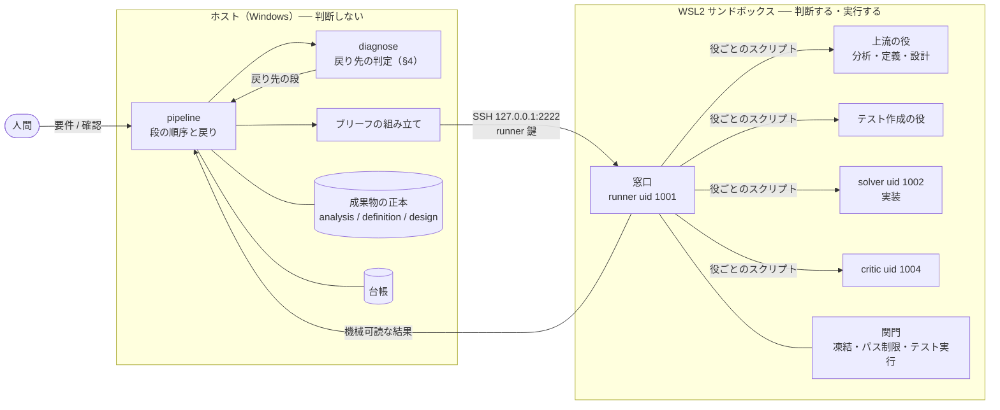
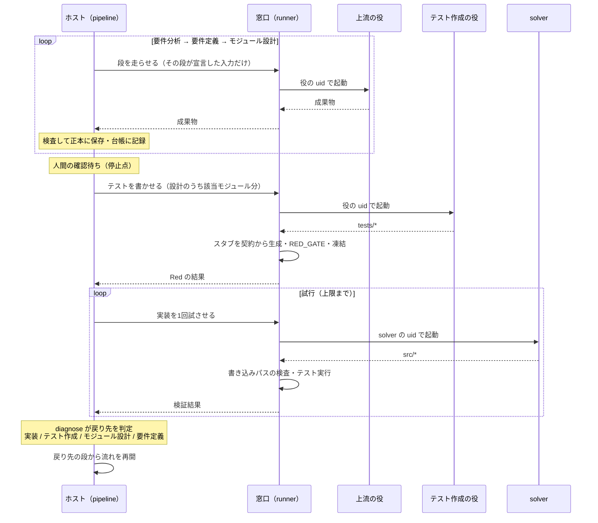

# REDESIGN.md — 定義と設計を深くして、実装を弱いモデルに任せる

> **状態: 提案。未実装。**
>
> 現状の形は [ARCHITECTURE.md](ARCHITECTURE.md)。この文書はそこから**何を変えるか**を述べる。

---

## 1. 考え方

**定義と設計を部分的に、深く書く。そうすれば実装は狭い仕事になり、弱いモデルでも担える。**

- 要件を分析し、定義し、**モジュール単位まで**設計する
- 設計からテストを起こし、テストから実装する
- テストが落ちたら、**どこまで戻るかを機械が判定する**。実装か、テストか、設計か
- 段から段への進行と戻りを、**人間ではなく機械がループとして回す**
- その機構は**サンドボックスの外**に置き、1つの流れとしてプログラムに書く。
  LLM と、生成されたコードの実行はサンドボックスの中に残す（§5）

実装は弱いモデルが行う。デバッグは、できる限り機械的に行う。

---

## 2. 流れ

```
要件分析 → 要件定義 → モジュール設計 → テスト作成 → 実装 → デバッグ
   ▲           ▲             ▲              ▲          ▲        │
   └───────────┴─────────────┴──────────────┴──────────┴────────┘
                  テストが落ちた地点で、戻り先を機械が判定する（§4）
```

| 段 | 出力 | 担い手 | いま |
|---|---|---|---|
| 要件分析 | 分析結果 | 未決 | **無い**（人間が `REQUIREMENTS.md` を書く） |
| 要件定義 | 要件ごとの定義 | 未決 | **無い**（同上） |
| モジュール設計 | モジュール・依存・組み立て | 未決 | **独立していない**（`tasks.json` が作る順序と一緒に暗黙に持つ） |
| テスト作成 | `tests/*` | 未決 | ある（TEST_WRITE → RED_GATE → FREEZE） |
| 実装 | `src/*` | **弱いモデル** | ある（IMPL） |
| デバッグ | 戻り先の判定 | **機械** | 一部（IMPL ⇄ VERIFY のリトライのみ。戻り先は常に実装） |
| 全体のループ | 状態・台帳 | **機械** | **無い**（次に打つ動詞を人間が覚えている） |

**各段の出力は機械が読める形にする。** §4 の判定は「テストが設計と合っているか」
「設計が定義と合っているか」を突き合わせることで行うので、突き合わせる相手が
散文だと判定できない。

---

## 3. なぜ深く設計するのか

### 弱いモデルは、狭い範囲なら実装できる

| | 結果 |
|---|---|
| run 6 | run 5 の計画をそのまま使い、ソルバーをローカルの 9B に替えた。**11/11 を全ステップ1回で緑** |
| run 8 | 9B が S1・S2・S4 の**実装を1回目で緑**（S1 は12テスト、S2 は17テスト） |
| run 8 S1 | RED_GATE を 12/12 で抜けたあと、**IMPL が文脈長で落ちた** |

最後の行は、範囲が広すぎれば弱いモデルは落ちることを示している。範囲を狭めることは
これに直接効く。

### 「深い」とは、判断を上流に寄せること

設計がシグネチャ、依存先、具体的な入出力の値まで決めていれば、実装は
**判断ではなく書き写し**になる。弱いモデルに残すのは書き写しだけにする。

### 組み立ても設計の一部にする

分割を細かくするほど、**モジュールの「間」にあるもの**が増える ── どれがどれを呼ぶか、
初期状態、起動経路。ここが誰の担当でもないと、部分は全部正しいのに全体が動かない。

- run 7: `production_rate` も `buy_generator` も `view` も正しかった。欠けていたのは
  「最初の資源を得る経路」で、**どのモジュールにも属していなかった**
- run 8 S1: `app.ts` は**作られ、テストされ、出荷物から呼ばれなかった**

だからモジュール設計は、モジュールの一覧だけでなく**組み立て**も1つの設計物として持つ。
組み立て自体も小さな実装単位として切り出し、弱いモデルの範囲に収める。

---

## 4. デバッグ ── 戻り先を機械が判定する

**テストが落ちた地点で、どこまで戻るかを決める。判定は機械的に行い、モデルに判断させない。**
いまのランナーの関門と同じ原則である ── 判定が judgement を含まないから価値がある。

### いまの穴

いまは VERIFY が落ちると、戻り先は常に実装である。テストのほうが間違っていると止まらない。

> run 8 の S5 で、`return storage.getItem(KEY)` という**完全に正しい実装が6回書かれて
> 6回落ちた。** テストが自前で書いた偽 Storage が `""` を `null` に潰していたため。

run 8 の未解決の失敗3件（S3 期待値リテラルの括弧落ち、S4 存在しないマッチャ、S5 上記）は
**どれもテスト側の誤り**で、どれも実装に戻され続けた。

### トレース

判定の前提として、**各テストは自分がどの設計項目から起こされたかを持ち、
各設計項目はどの定義項目から起こされたかを持つ。**

```
テスト ──→ 設計項目（モジュール・契約・具体値） ──→ 定義項目
```

テストが落ちたら、このつながりを上にたどって段ごとに整合を確かめる。
**最初に整合が崩れている段が戻り先になる。**

### 判定の順序（候補）

上から順に判定し、最初に当たったものを採る。

| # | 観測 | 判定 | 戻り先 |
|---|---|---|---|
| 1 | テストファイル自体が実行できない（構文エラー・存在しない API） | テストの誤り | テスト作成 |
| 2 | 失敗の発生箇所がテスト側のコード（モック・フィクスチャ）の中 | テストの誤り | テスト作成 |
| 3 | テストの期待値が、トレース先の設計項目の具体値と一致しない | テストの誤り | テスト作成 |
| 4 | 設計項目が、トレース先の定義項目と一致しない | 設計の誤り | モジュール設計 |
| 5 | 実装が、設計で宣言されていない他モジュールの機能を必要とする | 設計の誤り（境界） | モジュール設計 |
| 6 | 前のモジュールのテストを壊さずには通せない（PASS_TO_PASS） | 設計の誤り（境界） | モジュール設計 |
| 7 | 各モジュールは緑なのに、組み立てのテストが落ちる | 設計の誤り（組み立て） | モジュール設計 |
| 8 | 異なる実装で、N 回とも同じアサーションで落ちる | テストか設計を疑う | 3・4 を再判定し、どちらも整合していれば 9 へ |
| 9 | トレースが全段整合しているのに、試行を使い切った | **範囲が弱いモデルには広すぎる** | モジュール設計（分割し直す） |
| 10 | 上のどれにも当たらない | 実装の誤り | 実装 |

1 の一部は既にある ── コンパイルできないテストは、エスカレーションせずに書き直させている。

9 がこの設計の考え方に直結する。上流が全部正しく、それでも実装できないなら、
**直すのは実装ではなく分割の粒度**である。

### 戻ったあとに何が無効になるか

設計に戻ってモジュールの境界を変えると、**既に緑で凍結されているテストの一部は
意味を失う。** たとえば run 8 の S5（storage の読み出し）は S2 の storage モジュールに
依存しているので、S5 の判定で境界を引き直せば S2 の緑は意味を失うが、緑のまま残る。

いまは PASS_TO_PASS が「緑を壊さない」ことを保証している。**無いのは「緑を取り消す」
仕組み**である。モジュール設計の依存グラフがあれば、変えた設計項目より下流にある
テストと実装を機械的に洗い出して凍結を解ける。

### 上限

戻りにも上限を置く。上限に達したら人間へエスカレーションする。

---

## 5. 機構の置き場 ── 流れは外、判断は中

```
いま:   次に打つ動詞を人間が覚えている                  ← ループは操作者の中
提案:   ホスト側のプログラムが段を進め、§4 の判定で戻る  ← ループはプログラムの中
```

**ループ全体の機構をサンドボックスの外（ホスト）に置き、1つの流れとしてプログラムに書く。**
入口を1つ起動すれば、人間が動詞を打たずに最後まで回る（人間の確認が要る地点では止まる）。
狙いは2つ ── データの流れが読めること、そしてデバッグを機械化しやすくすること。

### 線の引き方

> **判断するものは全部サンドボックスの中。判断しないものは全部外。**

| | 何があるか | 置き場 |
|---|---|---|
| **判断するもの** | 上流の LLM（分析・定義・設計）、テスト作成、ソルバー、critic | サンドボックス。役ごとの uid で動く |
| **実行** | ソルバーが書いたコードと、テストの実行 | サンドボックス |
| **関門** | テストの凍結、書き込めるパスの制限 | サンドボックス。ファイル権限が担う |
| **判断しないもの** | 流れの制御、戻り先の判定、台帳、成果物の正本、ブリーフの組み立て | ホスト |

**ホストは LLM を直接呼ばない。サンドボックスに「この役を走らせて」と頼む。**
LLM はいまと同じくその役の uid で動き、何が見えるかはファイル権限が決める。
ホストで LLM を呼ぶと、隔離が権限からプログラムの規律に変わってしまう
（RUNNER_SPEC §0-3「検知より剥奪」から後退する）。中で呼べば剥奪のまま保てる。
仕組みも既にある ── runner から各役のスクリプトを呼ぶ sudoers の例外（1役につき
1スクリプト）と、それを役の視点で検査する `40-perms.sh` / `45-agent-invoke.sh`。

### 全体の配置



- ホストから中へ入る経路は **SSH 1本**（いまの git の経路と同じ `runner` 鍵）。
  `wsl -u` は root になれる経路なので、ループからは使わない
- 中の `runner` は流れを持たない**薄い窓口**になる。役を起動し、関門を適用し、
  結果を返すだけ
- 上流の役とテスト作成の役の uid は未決（§8）

### 1つの流れ



### サンドボックスの窓口

ホストが中に頼む操作は、次の数個に絞る。どれも**機械可読な結果**を返す。
この窓口が、データの流れが境界を越えるただ1つの場所になる。

| 操作 | 中で起きること | 返すもの |
|---|---|---|
| 役を走らせる | 入力をその役が読める場所に置き、役の uid で起動 | 成果物 |
| テストを書かせる | テスト作成の役を起動し、スタブを契約から生成し、RED_GATE | テストと Red の結果 |
| 凍結する | `tests/` を読み取り専用にし、マニフェストを採る | マニフェスト |
| 実装を1回試させる | solver を起動し、書き込めるパスを検査する | 変わったパス |
| 検証する | テスト全体を実行する | JUnit から読んだ結果 |

### 成果物の流れ

```
ホスト                                            サンドボックス
──────                                            ──────────────
成果物の正本 ──[その段が宣言した入力だけ]──▶ その役だけが読める場所 ──▶ 役（uid）
     ▲                                                                 │
     └──────────────────────[成果物・結果]─────────────────────────────┘
```

- **正本はホストに置く。** 呼び出しのたびに、その段が宣言した入力だけを中へ入れる。
  何がどこから来たかは、ホスト側の宣言だけで分かる
- 中に置いた写しが**その役以外から読めないこと**は、権限で保証する
- **ブリーフはホストで組み立てる。** ここに見せてはいけない内容を混ぜれば、権限では防げない。
  これはいまも同じで、組み立ては決まった手順のコードなので、テストで固定する
  （`test_brief.py`、「trace に要件を渡さない」など）

### ホスト側のファイル（案）

```
pipeline.py    段の順序と戻り。自分では何も作らない
diagnose.py    戻り先の判定（§4）
briefs.py      ブリーフの組み立て
artifacts.py   成果物の形式・トレース・各段の検査
ledger.py      台帳
```

サンドボックス側は、いまの `loop.py` から関門・テスト実行・役の起動を残したものが窓口になる。

### なぜこれがデバッグの機械化を助けるか

- **判定に要るものが全部ホストに揃う。** 分析・定義・設計の成果物と検証結果を、同じ場所で
  突き合わせられる
- **判定が純粋な関数になる。** `diagnose.py` は「成果物と検証結果を受け取り、戻り先の段を
  返す」だけ。モデルも状態も要らないので、それ自体をテストで固定できる。
  run 8 の S3〜S5 の成果物を、そのまま判定のテストの入力にできる
- **トレースがデータに乗る。** 設計項目とテストの対応は、`design.json` とテストが持つ
  ID として正本に残る。§4 の「上にたどって整合を確かめる」は、ファイルを読んで比べる処理になる
- **緑の取り消しが依存の追跡になる。** 各段が読むものと書くものを宣言していれば、
  ある成果物が変わったときに下流のどれが古くなったかは、ビルドツールと同じ方法で
  機械的に求まる
- **台帳と判定がソルバーの手の届かない場所にある。** いまの片方向の境界
  （ホストからは入れるが、中からは出られない）と向きが合う

### 状態と台帳

- **いまどの段にいるか、どの段が何を出したか、どの判定でどこへ戻ったか**を、ホストの台帳に残す
- **段単位でやり直せる。** いまは run 8 S1 のように IMPL だけが落ちても、復旧手段は
  `reset` しかなく、通ったばかりのテストまで捨てて引き直すことになる
- **サンドボックスが途中で消えても続きから回れる。** WSL はアイドルで落ちる。状態がホストの
  台帳にあれば、どの段のどの操作からやり直せばよいかが分かる
- 人間の確認が要る地点（いまの `plan apply` のような、基準を確定する境界）は、
  **「人間の判断待ち」という状態**として持たせる。止まることもデータにする

---

## 6. 今あるものと作るもの

| | |
|---|---|
| **そのまま使う** | TEST_WRITE / STUB（契約から機械が生成）/ RED_GATE / FREEZE / IMPL / VERIFY / 台帳 / ソルバーの差し替え |
| **作る** | ホスト側のプログラム（`pipeline.py` / `diagnose.py` ほか、§5）/ 要件分析・要件定義・モジュール設計の3段とその出力形式 / トレース / §4 の判定表 / 緑の取り消し / 新しい役の uid・置き場・権限とその検査 |
| **作り直す** | `tasks.json` の形式（モジュール設計と作る順序を分ける）/ リンタ L1〜L15（全部 `tasks.json` に対する規則）/ `loop.py`（約3,900行の1ファイル。流れの制御とブリーフの組み立てをホストへ移し、関門・テスト実行・役の起動を窓口として中に残す） |

`contracts.provides` / `requires` とスタブ生成器は、設計から機械的にコードを組む部品を
既に半分持っている。モジュール設計の層はその延長になる。

---

## 7. 代価

| | |
|---|---|
| **既存 run との比較** | run 1〜8 は「要件 → 計画 → 実装」で回した。段が増えると run 9 以降と直接は比べられない |
| **時間** | TypeScript のブートストラップは1試行28分だった。上流に段が増え、戻りも起きると1周が長くなる |

---

## 8. 未決の問い

1. **要件分析と要件定義を分けるか**
2. **上流（分析・定義・設計）を誰が書くか。** どのモデルが書くかと、どの uid で動かすか
   （いまの planner uid に担わせるか、段ごとに uid を分けるか）
3. **テストを誰が書くか。** run 8 で 9B は実装を1回目で通したが、未解決の失敗3件はどれも
   テストを書く段階のものだった。設計が具体的な入出力の値を持つなら、
   `expect(f(具体値)).toBe(具体値)` への変換に判断は要らず、機械が組み立てられる可能性がある
4. **各段の出力形式**（`analysis.json` / `definition.json` / `design.json` の中身）。§4 の突き合わせができる形でなければならない
5. **§4 の判定表の確定。** 各行を機械的に観測する方法と、8 の N
6. **粒度の基準。** どこまで分割すれば弱いモデルの範囲に収まるか。§4 の 9 が起きた回数がその手掛かりになる
7. **run 8 の扱い。** S1〜S4 は緑、S5 で停止中。S3〜S5 はテスト側の誤りと分かっている3件なので、
   §4 の判定表を新しい run を回さずに試す材料になる
