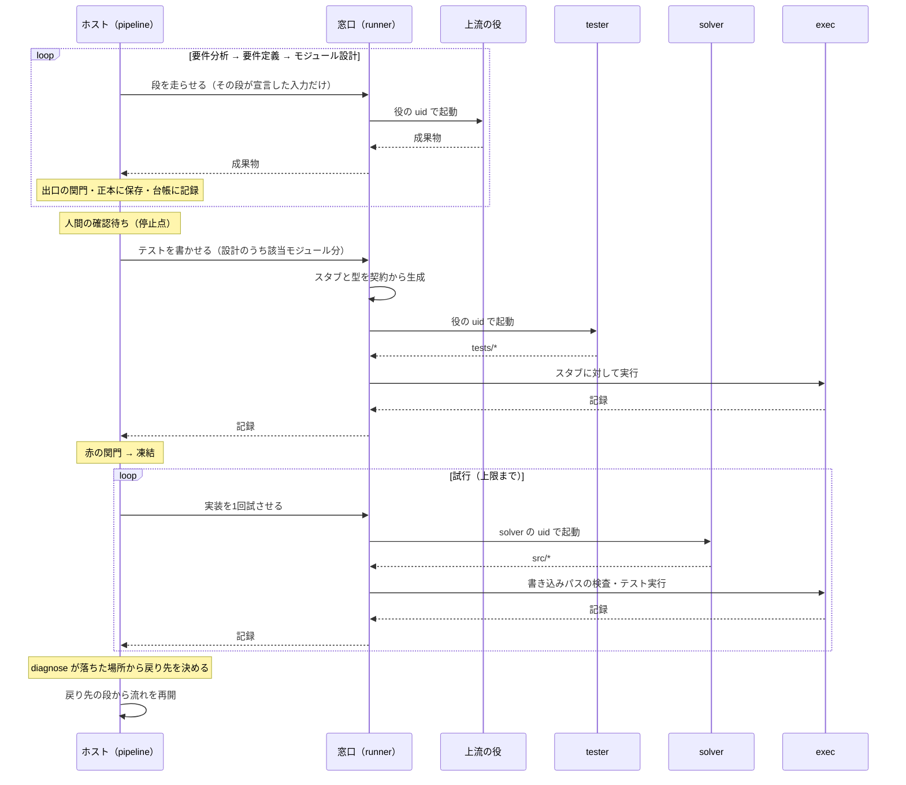

# REDESIGN.md — 定義と設計を深くして、実装を弱いモデルに任せる

> **状態: 設計中。未実装。** 決まったことは §10。
>
> 現状の形は [ARCHITECTURE.md](ARCHITECTURE.md)。この文書はそこから**何を変えるか**を述べる。
> 現状と合わない部分は、この文書に合わせて作り直す。

---

## 1. 考え方

**定義と設計を部分的に、深く書く。そうすれば実装は狭い仕事になり、弱いモデルでも担える。**

- 要件を分析し、定義し、**モジュール単位まで**設計する
- 設計からテストを起こし、テストから実装する
- テストが落ちたら、**落ちた場所でどの段が悪いかが決まる**ように流れを組む（§4）
- 段から段への進行と戻りを、**人間ではなく機械がループとして回す**
- その機構は**サンドボックスの外**に置き、1つの流れとしてプログラムに書く。
  LLM と、生成されたコードの実行はサンドボックスの中に残す（§6）
- **言語を選ばない。** 言語ごとの差はアダプタに閉じ込める（§5）

実装は弱いモデルが行う。デバッグは、できる限り機械的に行う。

---

## 2. 流れ

```
要件分析 → 要件定義 → モジュール設計 → テスト作成 → 実装 → デバッグ
   ▲           ▲             ▲              ▲          ▲        │
   └───────────┴─────────────┴──────────────┴──────────┴────────┘
                  落ちた場所が、戻り先の段を指す（§4）
```

| 段 | 出力 | 担い手 | いま |
|---|---|---|---|
| 要件分析 | 分析結果 | 未決 | **無い**（人間が `REQUIREMENTS.md` を書く） |
| 要件定義 | 外部インターフェースと例 | 未決 | **無い**（同上） |
| モジュール設計 | モジュール・契約・依存・組み立て・例 | 未決 | **独立していない**（`tasks.json` が作る順序と一緒に暗黙に持つ） |
| テスト作成 | `tests/*` | **Claude（tester uid）** | ソルバー（9B）が書いている。run 8 の未解決の失敗3件は全部ここ |
| 実装 | `src/*` | **弱いモデル** | ある（IMPL） |
| デバッグ | 戻り先の判定 | **機械** | 一部（IMPL ⇄ VERIFY のリトライのみ。戻り先は常に実装） |
| 全体のループ | 状態・台帳 | **機械** | **無い**（次に打つ動詞を人間が覚えている） |

**各段の出力は機械が読める形にする。** §4 の関門は「設計が定義を含んでいるか」
「テストが設計の例を使っているか」を突き合わせるので、突き合わせる相手が散文だと検査できない。

---

## 3. なぜ深く設計するのか

### 弱いモデルは、狭い範囲なら実装できる

| | 結果 |
|---|---|
| run 6 | run 5 の計画をそのまま使い、ソルバーをローカルの 9B に替えた。**11/11 を全ステップ1回で緑** |
| run 8 | 9B が S1・S2・S4 の**実装を1回目で緑**（S1 は12テスト、S2 は17テスト） |
| run 8 S1 | RED_GATE を 12/12 で抜けたあと、**IMPL が文脈長で落ちた** |

最後の行は、範囲が広すぎれば弱いモデルは落ちることを示している。範囲を狭めることは
これに直接効く。

### 「深い」とは、判断を上流に寄せること

設計がシグネチャ、依存先、具体的な入出力の値まで決めていれば、実装は
**判断ではなく書き写し**になる。弱いモデルに残すのは書き写しだけにする。

### 組み立ても設計の一部にする

分割を細かくするほど、**モジュールの「間」にあるもの**が増える ── どれがどれを呼ぶか、
初期状態、起動経路。ここが誰の担当でもないと、部分は全部正しいのに全体が動かない。

- run 7: `production_rate` も `buy_generator` も `view` も正しかった。欠けていたのは
  「最初の資源を得る経路」で、**どのモジュールにも属していなかった**
- run 8 S1: `app.ts` は**作られ、テストされ、出荷物から呼ばれなかった**

だからモジュール設計は、モジュールの一覧だけでなく**組み立て**も1つの設計物として持つ。
組み立て自体も小さな実装単位（組み立てモジュール）として切り出し、弱いモデルの範囲に収める。
**組み立てモジュールのテストは、定義の例そのもの**である（§4）。

---

## 4. デバッグ ── 落ちた場所が、悪い段を指す

**テストが落ちた場所だけで、どの段が悪いかが決まるように作る。** 落ちたあとで推理するのでは
なく、各段の誤りが**その段に対応する場所でしか表に出ない**ように流れを組む。
判定は機械が行い、モデルに判断させない ── いまのランナーの関門と同じ原則である。

### いまの穴

いまは VERIFY が落ちると、戻り先は常に実装である。テストのほうが間違っていると止まらない。

> run 8 の S5 で、`return storage.getItem(KEY)` という**完全に正しい実装が6回書かれて
> 6回落ちた。** テストが自前で書いた偽 Storage が `data[key] || null` で、`""` を `null` に潰していたため。

run 8 の未解決の失敗3件（S3 期待値リテラルの `{}` 落ち、S4 存在しないマッチャ `deepEquals`、
S5 上記）は**どれもテスト側の誤り**で、どれも実装に戻され続けた。

### 落ちたあとに推理する表では足りない

前の版は「観測 → 判定」の10行の表で、落ちたあとに戻り先を推理していた。これを run 8 に当てると、
**S5 はどの行にも当たらず「分割し直す」へ誤送される。** 偽 Storage は例外を投げず、間違った値を
返すだけで、テストの期待値 `""` は設計とも一致しているからである。

**テストの中に、検証されていないロジックがある限り、観測で捉えられない誤りが残る。**
だから表を精密にするのではなく、誤りが入り込む余地を潰し、潰しきれないものは**その段の出口で**止める。

### 3つの仕掛け

1. **期待値をテストに書かせない。** テストは設計の例（ID・入力・期待値）を、機械が配る比較関数で
   読み込み、呼び出し、1回だけ比べる。期待値のリテラルを誰も打たないので、S3 は構造的に起きない
2. **テストの中にロジックを置かない。** 偽物・ヘルパなど、判断を含むテスト側のコードは
   **支援モジュール**として設計に載せ、例を持たせ、使われる前にそれ自体の赤→緑を通す。
   S5 の偽 Storage は「`setItem(k, "")` のあと `getItem(k)` は `""`」という例で、使われる前に落ちる
3. **整合は各段の出口で確かめる。** 定義と設計、設計とテストの突き合わせを、失敗のあとではなく
   次の段へ渡す前に行う。**凍結されてから見つかるテストの誤りを無くす**

### テストの形

```
ex = example("M3.E2")                                    # 設計の例を読む（入力と期待値）
actual = current_cost(spec(ex.given.spec), ex.given.owned)
check(ex, actual)                                        # 1回だけ比べる。期待値は ex が持つ
```

- `example` / `check` / `check_raises` は機械が言語ごとに配る（§5）
- 比較は言語に依らない正規形で行う。浮動小数の許容誤差は設計の例が持つ
- 比較関数は**記録**を残す ── `START M3.E2`、`CHECK M3.E2 pass|fail 期待値 実際の値`。
  **判定はテストフレームワークの報告ではなく、この記録から読む。** フレームワークは走らせ役にすぎず、
  言語ごとの報告形式の差はここで消える
- 入力は**引数名で**持つ。tester の仕事は、例の入力を呼び出しに書き写すことだけになる

### 関門と帰責

```
要件定義 ─────────────────────────────────────────── 人間のレビュー
 │ 出口: 定義の関門                                        ▲
 モジュール設計 ──────────────────── 組み立てモジュールの検証（定義の例）
 │ 出口: 設計の関門 → スタブ生成                     ▲
  テスト作成 ── 出口: 赤の関門（スタブに対して）→ 凍結 │
   実装 ─────── 検証（モジュールの例）───────────────┘
```

| 落ちた場所 | 何が起きたか | 悪い段 |
|---|---|---|
| **定義の関門** | 形式違反 / 例の無い定義項目 / 同じ入力に違う期待値 | 要件定義 |
| **設計の関門** | 形式違反 / 依存の循環・未解決 / 組み立てから到達できないモジュール / 例の無い関数 / 同じ入力に違う期待値 | モジュール設計 |
| | 定義の例が、組み立てモジュールの例として**そのまま**含まれていない | モジュール設計 |
| **スタブ生成** | 設計の関門を通った契約から、アダプタがビルドできるスタブを作れない | **エンジン**（人間） |
| **赤の関門** | テストがビルド・読み込みできない / `START` が1件も無い | テスト作成 |
| | 設計の例のうち、どのテストにも使われていないものがある / 存在しない ID を読む | テスト作成 |
| | 1つのテストが `check` を0回、または2回以上呼ぶ | テスト作成 |
| | `START` のあと `CHECK` が無い（スタブに対して例外で落ちた） | テスト作成 ── スタブは契約どおりなので、落ちるのは呼び方が契約と合わないとき |
| | スタブに対して通ってしまう | テスト作成 ── 番兵は設計の全期待値と衝突しないよう機械が選ぶ |
| | 支援モジュールのテストが、tester の書いた支援モジュールで緑にならない | テスト作成 |
| **検証**（試行ごと） | 自分の例が落ちる / 例外 | 実装（もう一度） |
| | 前に緑だったテストが落ちる | 実装（もう一度） |
| | 設計で宣言していないモジュールを参照している | 実装（その試行は棄却して、もう一度） |
| **検証**（試行を使い切った） | 全試行が「宣言外の参照」 | モジュール設計（境界: 依存が足りない） |
| | 全試行が「前の緑を壊す」 | モジュール設計（境界: ぶつかっている） |
| | それ以外 | モジュール設計（粒度: 分割し直す） |
| **組み立ての検証**（使い切った） | 部品は全部緑なのに、定義の例が通らない | モジュール設計（分解・組み立て） |
| **人間のレビュー** | 遊んで駄目 | 要件定義・要件分析 ── どちらかは人間が選ぶ |

**読み方:** 凍結より前で落ちれば、その段が悪い。赤の関門で落ちればテストが悪い。
凍結のあとで落ちれば実装が悪く、使い切れば設計が悪い。**テストが凍結のあとで悪者になる経路は、
3つの仕掛けで塞いである。**

run 8 の3件はこう落ちる:

| | どこで | 戻り先 |
|---|---|---|
| S3（`{}` 落ち） | 起きない ── 期待値は例から読む | ── |
| S4（`deepEquals`） | 赤の関門 ── スタブに対して例外 | テスト作成 |
| S5（偽 Storage） | 赤の関門 ── 支援モジュールの例 `getItem` → `""` が緑にならない | テスト作成 |

### 使い切ったら、なぜ設計なのか

凍結された時点で、各テストが**設計の例そのものを、契約どおりの呼び方で**比べていることは
確かめてある。それでも通らないなら、残る原因は設計の側にしかない ── 範囲が弱いモデルには
広すぎる、依存が足りない、境界がぶつかる、例どうしが矛盾している。
**直すのは実装ではなく、分け方である。**

### 機械が判定できないもの

| | なぜ | 扱い |
|---|---|---|
| 型の合う取り違え（同じ型の引数を逆に渡す） | 赤の関門ではスタブが相手なので区別できない | 入力を引数名で持たせ、書き写しを機械的にする。残れば使い切り → 設計へ。分割し直しても同じ例で落ちたら人間へ |
| 設計の例どうしの一般的な矛盾 | 「同じ入力に違う期待値」以外は機械で見つからない | 使い切り → 設計へ。満たせなかった例の ID を渡す |
| 定義が人間の意図と違う | 機械の管轄外 | 人間のレビュー |
| エンジン（アダプタ・比較関数）の誤り | どの段のせいでもない | アダプタの適合テスト（§5）で先に潰す |
| 記録の偽装 | 比較関数の記録はテスト対象のコードと同じプロセスで書かれる | 実行は専用の uid（§6）。台帳と正本には触れられないが、同じプロセス内の偽装は防げない。弱いモデルが狙って行うことは想定しない |

### 戻すときに渡すもの

| 戻り先 | 渡す | 渡さない |
|---|---|---|
| 実装 | 落ちた例の ID・期待値・実際の値・例外 | ── |
| テスト作成 | どの関門規則で落ちたか、テストの出力 | 実装 |
| モジュール設計 | 満たせなかった例の ID と、理由の種類（境界・粒度・組み立て） | **実装が返した値** |
| 要件定義 | ── | **人間だけが戻せる** |

設計に戻っても、**定義から来た例は変えられない**（設計の関門が定義と突き合わせる）。
変えてよいのは分け方と、設計が自分で置いた例だけ。実装の値を見せないのは、見せれば設計が
それに合わせて「テストを緩めて通す」が、モデルを経由して戻ってくるからである。
**定義を変えられるのは人間だけ。**

### 戻ったあとに何が無効になるか

設計に戻ってモジュールの境界を変えると、**既に緑で凍結されているテストの一部は
意味を失う。** たとえば run 8 の S5（storage の読み出し）は S2 の storage モジュールに
依存しているので、S5 の判定で境界を引き直せば S2 の緑は意味を失うが、緑のまま残る。

いまは PASS_TO_PASS が「緑を壊さない」ことを保証している。**無いのは「緑を取り消す」
仕組み**である。モジュール設計の依存グラフがあれば、変えた設計項目より下流にある
テストと実装を機械的に洗い出して凍結を解ける。

### 上限

戻りにも上限を置く。上限に達したら人間へエスカレーションする。

---

## 5. 言語 ── アダプタ

**本体は言語を知らない。** 言語ごとの差は**アダプタ**に閉じ込める。新しい言語は、
アダプタを1つ足して適合テストを通せば使える。

> いまの `loop.py` は `LANGUAGE` の分岐で Python と TypeScript を切り替えている。
> ARCHITECTURE §6 にある通り、Python の文法が普遍的な規則の顔をしていた箇所は6回見つかった。
> 本体が言語を知っている限り、これは繰り返す。

### アダプタが持つもの

| | 内容 |
|---|---|
| 型の写像 | 設計の型（int / float / string / bool / list / map / record / enum / optional / error）→ その言語の型 |
| 型の生成 | **record・enum・error の定義は機械が生成する。** ソルバーが書くのは関数の中身だけ |
| スタブ生成 | 契約から、形は正しく値は番兵の実装を生成する。番兵は設計の全期待値と衝突しないものを機械が選ぶ |
| 比較関数 | `example` / `check` / `check_raises`。値を正規形に直し、記録を書き出す |
| 実行 | ビルドとテスト実行のコマンド。テストを1つずつ隔離し、時間制限つき・ネットワーク無しで走らせる |
| 参照の列挙 | `src/` のファイルが参照する他モジュール（§4「宣言外の参照」用） |

判定は比較関数の記録から読むので、走らせ役のテストフレームワークに求めるのは
**「テストを1つずつ隔離して走らせる」ことだけ**になる。報告形式（JUnit XML、`go test -json`、TAP ……）の差は判定に影響しない。

### 適合テスト

**アダプタを足すとは、適合テストを通すことである。** 全アダプタが、言語に依らない同じ小さな設計を受け取り、
正しい実装・壊れた実装・壊れたテスト（S4・S5 の形）・壊れた支援モジュールを与えられて、
**§4 の表どおりの場所で落ちる**ことを確かめる。run 8 の3件はここで固定する。

### 最初から対応する言語

WSL に入っているもの（2026-10-09 時点）。

| 言語 | 版 | 走らせ役 | 状態 |
|---|---|---|---|
| Python | 3.12 | pytest | 使っている |
| TypeScript / JavaScript | Node 22 | vitest | 使っている |
| Go | 1.22 | `go test` | 標準で入っている |
| Rust | 1.75 | `cargo test` | 標準で入っている。外部 crate 無し（正規形への変換も比較関数が自前で持つ） |
| Ruby | 3.2 | minitest 5.16 | 同梱 |
| Perl | 5.38 | Test::More / `prove` | 同梱 |
| Java | 21 | **無い** | JUnit が入っていない |
| PHP | 8.3 | **無い** | PHPUnit が入っていない |
| C / C++ | gcc / g++ 13 | **無い** | フレームワーク無し。C には例外が無いので error の写像が別 |

Go・Rust・Java・Ruby・PHP は**手で `apt install` されたもので、`provision/` に無い。**
箱を作り直すと消えるので、プロビジョンに入れる。

---

## 6. 機構の置き場 ── 流れは外、判断は中

```
いま:   次に打つ動詞を人間が覚えている                  ← ループは操作者の中
提案:   ホスト側のプログラムが段を進め、§4 の関門で戻る  ← ループはプログラムの中
```

**ループ全体の機構をサンドボックスの外（ホスト）に置き、1つの流れとしてプログラムに書く。**
入口を1つ起動すれば、人間が動詞を打たずに最後まで回る（人間の確認が要る地点では止まる）。
狙いは2つ ── データの流れが読めること、そしてデバッグを機械化しやすくすること。

### 線の引き方

> **判断するものは全部サンドボックスの中。判断しないものは全部外。**

| | 何があるか | 置き場 |
|---|---|---|
| **判断するもの** | 上流の LLM（分析・定義・設計）、テスト作成（tester）、ソルバー、critic | サンドボックス。役ごとの uid で動く |
| **実行** | ソルバーが書いたコードと、テストの実行 | サンドボックス。**実行専用の uid**（exec） |
| **関門** | テストの凍結、書き込めるパスの制限 | サンドボックス。ファイル権限が担う |
| **判断しないもの** | 流れの制御、関門の判定と帰責、台帳、成果物の正本、ブリーフの組み立て | ホスト |

**ホストは LLM を直接呼ばない。サンドボックスに「この役を走らせて」と頼む。**
LLM はいまと同じくその役の uid で動き、何が見えるかはファイル権限が決める。
ホストで LLM を呼ぶと、隔離が権限からプログラムの規律に変わってしまう
（RUNNER_SPEC §0-3「検知より剥奪」から後退する）。中で呼べば剥奪のまま保てる。
仕組みも既にある ── runner から各役のスクリプトを呼ぶ sudoers の例外（1役につき
1スクリプト）と、それを役の視点で検査する `40-perms.sh` / `45-agent-invoke.sh`。

### 新しい役

| 役 | uid | 担い手 | 書ける | **読めない** |
|---|---|---|---|---|
| **tester** | 1005 | Claude | `tests/`（凍結まで）、支援モジュール | `src/`、要件・定義、台帳、他のステップ |
| **exec** | 1006 | ── （モデルなし） | 記録の置き場 | 正本の写し以外の計画・設計、台帳 |

- **tester を planner と分ける**のは、設計の書き手とテストの書き手を別にするため。同じ主体が
  両方を書くと誤解も両方に入る。設計しか見られない別の役が迷わず書けるかどうかが、
  **設計が十分に深いかの検査**にもなる
- **exec を分ける**のは、いまテストが runner の uid で走り、ソルバーの書いたコードが
  runner の権限（`plan/` を読み、台帳を書ける）で実行されているため

### 全体の配置


- ホストから中へ入る経路は **SSH 1本**（いまの git の経路と同じ `runner` 鍵）。
  `wsl -u` は root になれる経路なので、ループからは使わない
- 中の `runner` は流れを持たない**薄い窓口**になる。役を起動し、関門を適用し、
  結果を返すだけ
- 上流の役の uid は未決（§10）

### 1つの流れ



### サンドボックスの窓口

ホストが中に頼む操作は、次の数個に絞る。どれも**機械可読な結果**を返す。
この窓口が、データの流れが境界を越えるただ1つの場所になる。

| 操作 | 中で起きること | 返すもの |
|---|---|---|
| 役を走らせる | 入力をその役が読める場所に置き、役の uid で起動 | 成果物 |
| テストを書かせる | 型とスタブを契約から生成し、tester を起動し、exec でスタブに対して実行 | テストと記録 |
| 凍結する | `tests/` を読み取り専用にし、マニフェストを採る | マニフェスト |
| 実装を1回試させる | solver を起動し、書き込めるパスと参照を検査する | 変わったパスと参照 |
| 検証する | exec でテスト全体を実行する | 記録 |

### 成果物の流れ

```
ホスト                                            サンドボックス
──────                                            ──────────────
成果物の正本 ──[その段が宣言した入力だけ]──▶ その役だけが読める場所 ──▶ 役（uid）
     ▲                                                                 │
     └──────────────────────[成果物・結果]─────────────────────────────┘
```

- **正本はホストに置く。** 呼び出しのたびに、その段が宣言した入力だけを中へ入れる。
  何がどこから来たかは、ホスト側の宣言だけで分かる
- 中に置いた写しが**その役以外から読めないこと**は、権限で保証する
- **ブリーフはホストで組み立てる。** ここに見せてはいけない内容を混ぜれば、権限では防げない。
  これはいまも同じで、組み立ては決まった手順のコードなので、テストで固定する
  （`test_brief.py`、「trace に要件を渡さない」など）。§4「戻すときに渡すもの」もここで固定する

### ホスト側のファイル（案）

```
pipeline.py    段の順序と戻り。自分では何も作らない
diagnose.py    関門の判定と帰責（§4）
briefs.py      ブリーフの組み立て
artifacts.py   成果物の形式・トレース・出口の関門
ledger.py      台帳
```

サンドボックス側は、いまの `loop.py` から関門・役の起動を残したものが窓口になり、
テストの実行はアダプタ（§5）を通して exec が行う。

### なぜこれがデバッグの機械化を助けるか

- **判定に要るものが全部ホストに揃う。** 分析・定義・設計の成果物と記録を、同じ場所で
  突き合わせられる
- **判定が純粋な関数になる。** `diagnose.py` は「成果物と記録を受け取り、戻り先の段を
  返す」だけ。モデルも状態も要らないので、それ自体をテストで固定できる
- **トレースがデータに乗る。** 例の ID が設計とテストの記録の両方に残るので、
  「どの例が、どこで落ちたか」はファイルを読んで比べる処理になる
- **緑の取り消しが依存の追跡になる。** 各段が読むものと書くものを宣言していれば、
  ある成果物が変わったときに下流のどれが古くなったかは、ビルドツールと同じ方法で
  機械的に求まる
- **台帳と判定がソルバーの手の届かない場所にある。** いまの片方向の境界
  （ホストからは入れるが、中からは出られない）と向きが合う

### 状態と台帳

- **いまどの段にいるか、どの段が何を出したか、どの関門でどこへ戻ったか**を、ホストの台帳に残す
- **段単位でやり直せる。** いまは run 8 S1 のように IMPL だけが落ちても、復旧手段は
  `reset` しかなく、通ったばかりのテストまで捨てて引き直すことになる
- **サンドボックスが途中で消えても続きから回れる。** WSL はアイドルで落ちる。状態がホストの
  台帳にあれば、どの段のどの操作からやり直せばよいかが分かる
- 人間の確認が要る地点（いまの `plan apply` のような、基準を確定する境界）は、
  **「人間の判断待ち」という状態**として持たせる。止まることもデータにする

---

## 7. プロビジョン ── 箱は機械だけを作る

`provision/` は、まっさらな Ubuntu からサンドボックスを組み立てる手順である。
いまの手順は旧い形（1プロジェクト・2言語・3役）に合わせて書かれており、新しい形では
**次の4点を根本から変える。** いずれも 2026-10-09 に WSL の中の実際の状態で確かめた。

### 7-1. 機械と作業場を分ける

いまのプロビジョンは、機械の設定と、特定のプロジェクトの中身を一緒に作っている。

| スクリプト | 機械の設定 | **プロジェクトの中身**（ここに在るべきでないもの） |
|---|---|---|
| `20-layout.sh` | `/srv/loop` | `project/` と Python 用の `conftest.py` |
| `30-python.sh` | Python | `project/.venv` |
| `35-node.sh` | vitest・happy-dom | `vitest.config.mjs` と、**ゲーム用の `index.html`**（`/src/main.ts` の `start` を呼ぶ） |

`index.html` は設計の「組み立て」が決めるものであり、`conftest.py` や `vitest.config.mjs` は
アダプタ（§5）が持つものである。言語が増えるたびにこの種のファイルがプロビジョンに増えていく。

- **プロビジョンは機械だけを作る** ── ユーザー、言語のツールチェーン（読み取り専用の共有の置き場）、権限、SSH、通信の制限
- **作業場は窓口が作る** ── run ごと・モジュールごとに、ホストの正本とアダプタから組み立てる。
  §6「サンドボックスが途中で消えても続きから回れる」は、作業場をいつでも作り直せることが前提

### 7-2. 役を1つの表から生成する

いまは solver・planner・critic の3役を、それぞれ手で書いている ── ユーザー（`10-users.sh`）、
グループ、brief/out のディレクトリと sudoers の 91〜93（`45-agent-invoke.sh`）、
役の視点での検査（`40-perms.sh` と `45-agent-invoke.sh` に別々に）。
新しい形では tester・exec・上流の役が加わり、7〜8役になる。

手で書いた検査には抜けが出る。`tests/` が誰にでも読めていたのは、critic 用の検査を
**たまたま**書いたときに見つかった（ARCHITECTURE §2）。

**役の表を1つ持ち、ユーザー・グループ・ディレクトリ・sudoers・認証情報・通信の制限・検査を
すべてそこから生成する。** 検査は「全部の役 × 全部の場所」の総当たりにする。
表に書いたことは全部確かめられ、書いていないことは全部拒まれる。

表の列（案）:

| 列 | 内容 |
|---|---|
| 役 | 名前と uid |
| 担い手 | モデル（Claude / ローカル / なし） |
| 読める | brief、ツールチェーン、作業場のどこか |
| 書ける | out、`src/`、`tests/`、記録の置き場 |
| 読めない | 明示する。総当たりの検査はここを確かめる |
| 認証情報 | `/etc/loop/<役>.env` の有無と、誰が読めるか |
| 外への通信 | 7-3 |
| 起動の経路 | runner からの sudoers 例外（1役1スクリプト） |

### 7-3. 外への通信を役ごとに制限する

**いまは誰も制限されていない。** `60-egress.sh` は `provision.sh` から呼ばれておらず、
solver から外部（1.1.1.1:443）へ接続できた。テストは runner の uid で走っているので、
ソルバーが書いたコードも外へ出られる。

| 役 | 必要な通信 |
|---|---|
| tester・上流の役・critic（Claude） | Anthropic の API だけ |
| solver（ローカルの 9B） | loopback（`llm-serve`）だけ |
| exec（生成コードの実行） | **なし** |
| runner | なし（ホストからの SSH を受けるだけ） |

uid ごとの制限（`iptables -m owner`）を役の表から生成し、プロビジョンの一部として必ず走らせる。

### 7-4. SSH の鍵で窓口しか開かない

**いまは runner の鍵に制限が無く、ホストから入ると何でもできるシェルになる。**
§6 は「窓口が、データの流れが境界を越えるただ1つの場所」と言うが、それはいま規律でしかない。

`authorized_keys` に強制コマンド（`command="..."`）を付け、この鍵で起動できるものを
**窓口の操作と、git の取得（`git-upload-pack`）だけ**にする。検知より剥奪を、窓口にも当てはめる。
保守用の入口（既定ユーザー）は別の鍵で、ループからは使わない。

### それに伴って直すもの

| | |
|---|---|
| 書き込みの分担 | いまは solver が `src/` と `tests/` の両方に書ける（`solverw`）。`tests/` は tester、`src/` は solver に分ける |
| 言語 | Go・Rust・Java・Ruby・PHP は手で `apt install` されたもので手順に無い。手順に入れる。Java・PHP・C/C++ の走らせ役も決めれば同様（§10） |
| ネットワーク無しのビルド | exec がビルドするためのキャッシュの置き場（Go のビルドキャッシュ、cargo の target など）と、オフラインの設定（Go modules・cargo）。外部の依存は使えない前提 |
| 認証情報 | tester と上流の役ごとに `/etc/loop/<役>.env`（いまの planner・critic と同じ形）。互いに読めない |
| 既定ユーザー | スクリプトの既定は `maint` だが、この機械の既定ユーザーは `yoshito` |
| 旧い説明 | `20-layout.sh` の「planner（Windows）が `repo.git` に push する」は旧い形 |

---

## 8. 今あるものと作るもの

| | |
|---|---|
| **そのまま使う** | FREEZE / IMPL / 台帳の考え方 / ソルバーの差し替え / 役ごとの sudoers 例外という形 / 役の視点で検査するという考え方 |
| **作る** | ホスト側のプログラム（`pipeline.py` / `diagnose.py` ほか、§6）/ 要件分析・要件定義・モジュール設計の3段とその出力形式 / 出口の関門 / 比較関数と記録 / 支援モジュール / 緑の取り消し / tester・exec の uid と権限とその検査 / アダプタ（§5 の言語分）と適合テスト / 役の表と、そこからの生成・総当たりの検査（§7-2）/ 役ごとの通信の制限（§7-3）/ SSH の強制コマンド（§7-4） |
| **作り直す** | TEST_WRITE（ソルバーから tester へ）/ STUB（アダプタへ。番兵は設計の期待値から選ぶ）/ RED_GATE と VERIFY（JUnit ではなく記録から読む）/ `tasks.json` の形式（モジュール設計と作る順序を分ける）/ リンタ L1〜L15（全部 `tasks.json` に対する規則）/ `loop.py`（約3,900行の1ファイル。流れの制御とブリーフの組み立てをホストへ移し、関門と役の起動を窓口として中に残す）/ `provision/`（機械だけを作る形へ。作業場の組み立ては窓口とアダプタへ、§7-1） |

`contracts.provides` / `requires` とスタブ生成器は、設計から機械的にコードを組む部品を
既に半分持っている。モジュール設計の層とアダプタはその延長になる。

---

## 9. 代価

| | |
|---|---|
| **既存 run との比較** | run 1〜8 は「要件 → 計画 → 実装」で回した。段が増えると run 9 以降と直接は比べられない |
| **時間** | TypeScript のブートストラップは1試行28分だった。上流に段が増え、戻りも起きると1周が長くなる |
| **アダプタ** | 最初から §5 の言語分。型の写像・型の生成・スタブ・比較関数・参照の列挙を言語ごとに書き、適合テストで固定する |
| **プロビジョン** | 役の表から生成する形への書き直し。いまの箱は作り直しになる |
| **設計の手間** | 支援モジュールと、全関数の例を設計が持つ。設計の段が重くなる ── これが「判断を上流に寄せる」の代価そのもの |

---

## 10. 決まったことと、未決の問い

### 決まったこと（2026-10-09）

1. **デバッグは「落ちた場所が、悪い段を指す」形にする**（§4）。期待値はテストに書かせず、
   テスト側のロジックは支援モジュールにし、整合は各段の出口で確かめる
2. **テストは Claude が書く。** 役は新しい uid `tester`（planner とは分ける）
3. **テストの実行は新しい uid `exec`** で行う
4. **言語はアダプタ方式。** WSL に入っている言語に最初から対応する（§5）
5. **プロビジョンを作り直す**（§7）。機械と作業場を分け、役を1つの表から生成し、通信を役ごとに制限し、SSH の鍵では窓口しか開かない

### 未決の問い

1. **要件分析と要件定義を分けるか**
2. **上流（分析・定義・設計）を誰が書くか。** どのモデルが書くかと、どの uid で動かすか
   （いまの planner uid に担わせるか、段ごとに uid を分けるか）
3. **各段の出力形式**（`analysis.json` / `definition.json` / `design.json` の中身）。§4 が要求する最小限は:
   - 定義 ── 外部インターフェースと、その例（ID・入力・期待値）
   - 設計 ── モジュール（通常・支援・組み立て）、言語に依らない型での契約、依存、例（ID・引数名つきの入力・期待値・許容誤差・由来する定義の例）
4. **例で表しにくいもの。** 入力を変えないこと（不変性）、時間・乱数・I/O などの副作用、画面（DOM）をどこまで例で持つか
5. **Java・PHP・C/C++ の走らせ役。** フレームワーク（JUnit・PHPUnit・GoogleTest）をプロビジョンで入れるか、アダプタが最小の走らせ役を持つか
6. **粒度の基準。** どこまで分割すれば弱いモデルの範囲に収まるか。「使い切り → 粒度」が起きた回数がその手掛かりになる
7. **試行回数と戻りの上限の値**
8. **役の表の中身。** 上流の役の uid（2 と同じ問い）、Anthropic の API として許す宛先、窓口の強制コマンドが受け付ける操作の一覧
9. **run 8 の扱い。** run 8 のテストは比較関数を使っていないので、そのままでは判定の入力にならない。
   S4・S5 の形を写して、適合テストの材料にする
