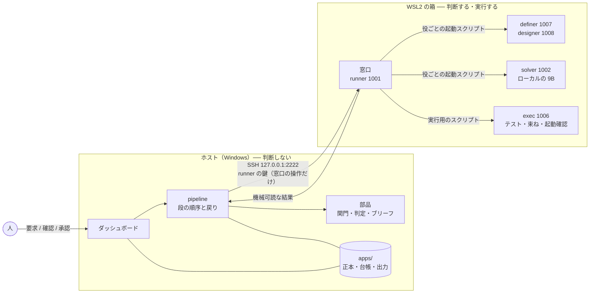

# SYSTEM.md — どこに置き、どう守るか

ループの機構をどこに置き、生成されたものから何をどう守るか。何を作るか（流れ・段・関門と帰責）は
[DESIGN.md](DESIGN.md)、箱を作る手順と落とし穴は [provision/README.md](../provision/README.md)、
Windows 側の起動は [host/README.md](../host/README.md) にある。

---

## 1. 線の引き方 ── 流れは外、判断は中

> **判断するものは全部サンドボックス（箱）の中。判断しないものは全部外（ホスト）。**

| | 何があるか | 置き場 |
|---|---|---|
| **判断するもの** | 上流の LLM（分析・定義・設計）、支援モジュール（tester）、solver、評価役 | 箱。役ごとの uid で動く |
| **実行** | solver が書いたコードと、テストの実行、出力の束ねと起動確認 | 箱。**実行専用の uid**（exec） |
| **関門の強制** | 作業場に書けるのは窓口だけ、役ごとの通信の制限 | 箱。ファイル権限と iptables が担う |
| **判断しないもの** | 流れの制御、関門の判定と帰責、台帳、成果物の正本、ブリーフの組み立て、ダッシュボード | ホスト（Windows） |

**ホストは LLM を直接呼ばない。箱に「この役を走らせて」と頼む。** LLM はその役の uid で動き、何が見えるかは
ファイル権限が決める。ホストで LLM を呼ぶと、隔離が権限からプログラムの規律に変わってしまう ──
「してはいけないことを見張って検知する」より「そもそもできないように権限を剥がす」を選ぶ、という原則から後退する。
中で呼べば、剥奪のまま保てる。

ループ全体の流れはホストに置き、1つのプログラムに書く（§6）。入口を1つ起動すれば、人が動詞を打たずに
最後まで回る。狙いは2つ ── データの流れが読めること、そしてデバッグを機械化しやすくすること。

---

## 2. 役

役は uid である。何を見られるかはプロンプトの約束ではなく、ファイルシステムが決める。
正本は `provision/roles.json` で、ユーザー・グループ・置き場・sudoers・通信の制限・検査はすべてそこから生成する（§8）。

| 役 | uid | 担い手 | 書ける | 通信 | 何をするか |
|---|---|---|---|---|---|
| **runner** | 1001 | ── | 作業場（窓口として） | なし | 窓口。ホストからの SSH を受け、役を起動し、検査して作業場へ写す。流れは持たない |
| **solver** | 1002 | ローカルの 9B | 自分の `out/` だけ | loopback の 8080（推論サーバ）だけ | モジュールを1つ実装する |
| **critic** | 1004 | Claude | 自分の `out/` だけ | 制限なし（道具で剥奪） | **評価役。** 観点ごとに、動かした証拠を見て改良案を出す。読むのは概念ファイルと証拠だけで、コードも定義も読まない（未実装） |
| **tester** | 1005 | Claude | 自分の `out/` だけ | 制限なし（道具で剥奪） | 支援モジュールの中身を書く（未実装） |
| **exec** | 1006 | ── | 自分の `out/` だけ（記録） | **なし** | テストの実行、出力の束ねと起動確認。作業場は**読むだけ** |
| **definer** | 1007 | Claude | 自分の `out/` だけ | 制限なし（道具で剥奪） | 最初の定義（MVP）を書く。**2周目からはレビュアー**と呼び、コードを読んで改良ファイルを書く（未実装） |
| **designer** | 1008 | Claude | 自分の `out/` だけ | 制限なし（道具で剥奪） | モジュール設計を書く |
| **llm** | （システム） | ── | ── | なし | 推論サーバ（llama-server）を動かす |

- **どの役も作業場に書かない。** 役は自分の `out/` にだけ書き、窓口がそれを検査して作業場へ写す（§8-5）。
  作業場のファイルは全部 runner の持ち物なので、テストの凍結のために何かをする必要がそもそも無い
- **定義と設計を別の uid にする。** 設計の関門は「設計が定義の例を含んでいるか」を突き合わせるので、
  同じ主体が両方を書くと、この突き合わせが形だけになる
- **tester を設計の書き手と分ける。** 同じ主体が設計と支援モジュールの両方を書くと、誤解も両方に入る
- **exec を分ける。** 生成されたコードを、流れや正本に触れられる uid で走らせない
- Claude の役は `--allowedTools "Read Write Edit"`（critic は Read Write）で起動し、Bash も WebFetch も持たない（§8-3）
- **役を分けるのは、理由が3つのどれかにあるときだけ**（DECISIONS 決定 25）: 見せてはいけないものがある、
  片方が片方を確かめる、能力や費用が違う。それ以外はまとめる。役が増えると、段を渡るたびに意味が縮み、
  呼び出しの費用と保守するものが増え、役と役の間が誰の担当でもなくなる
- **分析役**（Claude）は新しい uid で作る（**未作成**）。概念ファイルだけを書く。改良役を別に作らず definer が
  レビュアーを兼ねるのは、改良が定義から始まり、分ける理由が無いから（DECISIONS 決定 26）
- 評価役（critic）とレビュアー（definer）を分けている理由は、評価役に**コードを見せない**ことにある。コードを読める役は
  今あるものを前提に考え始め、使う側でしか見えない問題に気づきにくい（旧い形の critic で実測した）

---

## 3. 全体の配置



- ホストから箱へ入る経路は **SSH 1本**（runner の鍵）。`wsl -u` は root になれる経路なので、ループからは使わない
- 箱の中の runner は流れを持たない**薄い窓口**である。役を起動し、検査し、結果を返すだけ

---

## 4. 窓口

ホストが箱に頼む操作は、次の数個に絞る。どれも `ssh loop-runner "<操作> <作業場> <モジュール>"` で、
入力は標準入力の JSON、答えは標準出力の JSON。この窓口が、データが境界を越えるただ1つの場所になる。
本体は `engine/window.py`（箱では `/srv/loop/lib/engine/window.py`）、入口は `provision/bin/loop-window`。

| 操作 | 箱の中で起きること | 返すもの |
|---|---|---|
| `ping` / `status` | 生きているか。推論サーバと通信の制限が動いているか、作業場の空き | 状態 |
| `prepare-tests` | 設計から作業場を組み立て直し（緑のモジュールは保存した実装、他はスタブ）、exec でそのモジュールのテストをスタブに対して走らせる | 記録 |
| `attempt` | solver の置き場にブリーフと現状を置き、solver を起動し、`out/` の候補を `verify` に渡す | 記録 |
| `verify` | 候補（そのモジュールのファイル1つだけ）を作業場に置き、そのモジュールと緑のモジュール全部のテストを exec で走らせる | 記録 |
| `accept` | 緑になった実装を保存し、以後の組み立てで戻す | ok |
| `build-app` | 組み立てと汎用シェルを束ね、1つの HTML にし、起動確認する（どちらも exec） | HTML と起動確認の結果 |
| `run-role` | ブリーフを上流の役の `in/` に置いて起動し、`out/` に残したファイルを返す | ファイル |
| `list-repos` / `git-upload-pack` | ホストのミラー用（旧い形の名残。いまは引くものが無い。PROGRESS の整理の残り） | ── |

**凍結の操作は無い。** 作業場には窓口しか書けないので、凍結は最初から成り立っている。

---

## 5. 成果物の流れと正本

```
ホスト（正本）                                        箱
──────────────                                        ──
apps/<名前>/ ──[その段が要る入力だけ]──▶ その役だけが読める in/ ──▶ 役（uid）
     ▲                                                                │
     └──────────────────[成果物・結果（out/ を窓口が検査）]────────────┘
```

**正本はホストに置く。** 呼び出しのたびに、その段が要る入力だけを箱に入れる。何がどこから来たかは、
ホスト側だけで分かる。箱に置いた写しが**その役以外から読めないこと**は、権限で保証する。

```
apps/<名前>/
  app.json            名前・題名・プラットフォーム
  requirements.md     人が書いた要求（名前は「要求」に改める予定。DECISIONS 決定 24）
  concepts.json       概念ファイル（未実装）
  improvements/       改良ファイル。追記だけで、最初の定義は書き換えない（未実装、形は DECISIONS 未決 16）
  definition.json     最新の定義
  design.json         最新の設計
  decisions.jsonl     人が通しについて決めたこと（承認・差し戻し）。追記だけ
  runs/<run>/
    run.json          始まった時刻
    ledger.jsonl      その通しの台帳
    definition.json   その通しが書いた定義と設計（要求から作ったとき）
    design.json
    outcome.json      どう終わったか
    app.html          出力（束ねて起動確認を通ったとき）
    run.pid           動いているあいだ
```

**ブリーフはホストで組み立てる**（`engine/briefs.py`・`engine/upstream_briefs.py`）。ブリーフに見せてはいけない
内容を混ぜれば、権限では防げない。組み立ては決まった手順のコードなので、テストで固定する。
「戻すときに渡すもの・渡さないもの」（DESIGN §5）もここで固定する。

---

## 6. 流れは1つのファイルに、ほかは部品

**ループの流れ ── どの段が何を受け取り、何を出し、どこへ戻るか ── は `engine/pipeline.py` 1つに、
上から下へ読める形で書く。** データの流れを追うときに読むのは、このファイルだけで済むようにする。

```python
def run_from_requirements(requirements, ...):
    definition = _write_by_role(..., "definer", ...)      # 定義の関門で落ちたら同じ役へ
    for round in range(redesigns + 1):
        design = _write_by_role(..., "designer", ...)     # 設計の関門
        out = run(design, ...)                            # モジュールごとに: 赤の関門 → 試行 → 緑 → 出力
        if out.stage != DESIGN: return out                # 使い切りなら、ids と理由だけ持って designer へ
```

それ以外は全部、**流れを持たない部品**にする。入力を受け取って結果を返すだけで、自分から次の段を呼ばない。
旧い形のランナー（約 3,900 行の1ファイル）が読みにくかったのは、1ファイルだったからではなく、
**流れと部品が混ざっていたから**である。

| ファイル | 部品 |
|---|---|
| `engine/pipeline.py` | **流れ。** 段の順序と戻り、台帳への記録、箱への SSH。自分では何も作らない |
| `engine/diagnose.py` | 記録から戻り先を返す（DESIGN §5） |
| `engine/artifacts.py` | 定義と設計の出口の関門。指摘は悪い段と場所を持つ |
| `engine/briefs.py` | solver のブリーフ |
| `engine/upstream_briefs.py` | definer・designer のブリーフ |
| `engine/window.py` | 窓口の操作（箱の中で runner として動く） |
| `engine/apps.py` | アプリの置き場（§5）。読み書きだけで、何も決めない |
| `engine/cli.py` | 入口: `list`・`new`・`run`・`stop` |
| `adapters/` | 設計から作業場を作る、走らせ方を返す、シェル（DESIGN §7） |
| `host/dashboard/` | ダッシュボード（§9） |

**数に入れないもの:** 作業場の中の生成物（テスト・型・スタブ・`examples.json`）は、誰も手で直さず、
`design.json` から毎回作り直す。生成は分岐も状態も持たない一本道（設計 → 作業場 → 記録）なので、
いくつのファイルに分かれていても流れは増えない。

**1ファイルにできないもの:** ホストの pipeline と箱の窓口（マシンの境界）、役ごとの起動スクリプト
（sudo を1役1スクリプトに絞るため）、言語ごとの比較関数（作業場の中でテスト対象と同じ言語で動く）。
どれも安全の仕組みそのもので、pipeline から見れば流れを持たない「呼ぶ相手」である。

---

## 7. 状態と台帳

- **通しごとの台帳**（`runs/<run>/ledger.jsonl`）に、どの段にいるか、どの段が何を出したか、どの関門で
  どこへ戻ったかを残す。長い段は始まりも書く（`BEGIN`）ので、動いている途中でも何をしているかが見える
- **通しの状態はファイルから読み、覚えない。** 動いているか・終わったか・止められたかは、`run.pid`・
  `outcome.json`・台帳から決まる。ダッシュボードもコマンドラインも、自分の状態を持たない
- **通しは、全部のアプリを通して同時に1つだけ。** 箱の solver の置き場が1つだからで、`apps/.running` で守る
- **止めるのはファイルで伝える**（`runs/<run>/stop`）。流れはモジュールの間と試行の間でそれを見て、きれいに終わる。
  Windows ではシグナルが強制終了になり、強制終了された通しは結果を書けないため
- **箱が途中で消えても、正本と台帳はホストに残る。** 作業場はいつでも設計から作り直せる

### なぜこれがデバッグの機械化を助けるか

- **判定に要るものが全部ホストに揃う。** 定義・設計の正本と記録を、同じ場所で突き合わせられる
- **判定が純粋な関数になる。** `diagnose.py` は「設計と記録を受け取り、戻り先の段を返す」だけ。
  モデルも状態も要らないので、それ自体をテストで固定できる
- **トレースがデータに乗る。** 例の ID が設計とテストの記録の両方に残るので、「どの例が、どこで落ちたか」は
  ファイルを読んで比べる処理になる
- **台帳と判定が solver の手の届かない場所にある。** ホストからは入れるが、中からは出られない

---

## 8. 箱 ── 機械だけを作る

箱は WSL2 の `Ubuntu-24.04`。`provision/` がまっさらな Ubuntu から組み立てる。手順と落とし穴は
provision/README.md。ここには、なぜその形かを書く。

### 8-1. 機械と作業場を分ける

**プロビジョンは機械だけを作る** ── ユーザー、言語のツールチェーン（root の持ち物で、全役が実行でき、誰も
変えられない共有の置き場）、権限、SSH、通信の制限。**作業場は窓口が作る** ── 通しごと・モジュールごとに、
ホストの正本とアダプタから組み立てる。

作業場の中身（テストの設定、ページの雛形）をプロビジョンが作ると、言語やプラットフォームが増えるたびに
プロビジョンが膨らみ、特定のアプリの事情が機械に入り込む。それはアダプタとプラットフォームの持ち物である。

**環境は凍結する。** ツールチェーンは版を固定して入れ、自動更新を止める。関門の意味が、通しの途中で
誰も選ばないまま変わらないように。

### 8-2. 役を1つの表から生成する

役の表（`provision/roles.json`）を1つ持ち、ユーザー・グループ・置き場・sudoers・認証情報・通信の制限・
検査を**すべてそこから生成する**（`provision/roles.py`）。検査は「全部の役 × 全部の場所」の総当たり
（8 役 × 40 か所、920 通り）。表に書いたことは全部確かめられ、書いていないことは全部拒まれる。

手で書いた検査には抜けが出る。旧い形では、ある役の検査をたまたま書いたときに、テストが誰にでも読めていたことが見つかった。

表の列: 役の名前と uid、担い手（Claude / ローカル / なし）、起動されるか、通信、道具、ログインの形。
認証情報は Claude の役ごとに `/etc/loop/<役>.env`（root:<役> 640）で、互いにも runner からも読めない。

### 8-3. 外への通信を役ごとに制限する

| 役 | 通信 | 何が守っているか |
|---|---|---|
| **exec**（生成コードの実行） | **なし** | uid ごとの制限（`iptables -m owner`）。起動のたびに `loop-egress.service` が当て直す |
| **solver**（ローカルの 9B） | loopback の 8080（推論サーバ）だけ | 同上 |
| runner | なし（ホストからの SSH を受けるだけ） | 同上 |
| Claude の役 | 宛先を絞らない | **使える道具**。Bash も WebFetch も持たない。外へ出るのは CLI 自身の API 通信だけ |

Claude の役に宛先の一覧を持たせないのは、守るものが無いからではない。通信の制限が守るのは環境の凍結
（外から取ってこない）と認証情報（外へ送らない）であり、Claude の役ではそれを**道具を渡さないことで**既に
剥奪している。**Claude の役に Bash や WebFetch を足すときは、この行を見直す。**

### 8-4. SSH の鍵で窓口しか開かない

runner の鍵は `authorized_keys` で強制コマンド（`restrict,command="/srv/loop/bin/loop-window"`）を付けてあり、
この鍵で起動できるのは窓口の操作だけ（§4）。ホストから入っても、何でもできるシェルにはならない。
保守用の入口（既定ユーザー）は別の鍵で、ループからは使わない。保守用ユーザーは実質 root なので、
ループに含めれば役の縛りが意味を失う。

### 8-5. 作業場に書けるのは窓口だけ

役は自分の `out/` にだけ書く。solver の出力も tester の支援モジュールも、窓口が書き込めるパスを検査してから
作業場へ写す。exec は作業場を読むだけ。こうすると:

- 作業場の全ファイルが runner の持ち物になり、凍結は「誰も書けない」ことで最初から成り立つ
- solver・tester が作業場を読む必要も無い。要るものはブリーフで渡す

これは最初、規律でしかなかった。runner の umask が 002 なので、窓口がふつうに作った作業場はグループに書け、
そのグループには exec がいた ── テストしている当のコードに書き込めた。`work/` と各 `in/` に既定 ACL
（グループは読みと通過だけ）を付けてディレクトリの性質にし、検査にも「runner があとから作るもの」を加えた。

exec は作業場に書けないので、ビルドの出力やキャッシュは exec の home か専用の一時ディレクトリに出す。
アダプタが守る前提である。

---

## 9. ダッシュボード

`host\loop-dashboard.cmd`（`host/dashboard/server.py`）。アプリの一覧、通しとモジュールごとの状態・試行・判定、
いま何をしているか（台帳の `BEGIN` と経過時間）、出力アプリをその場で遊ぶ、箱の状態（窓口の `status`）。

| 操作 | どこから |
|---|---|
| 見る、差し戻す、通しを止める | どこからでも |
| アプリを作る、通しを始める、承認する | **この PC からだけ** ── 機械を使うのも、遊んで決めるのも、その前にいる人 |

出力アプリは CSP の sandbox と sandbox の iframe の中で開く。ダッシュボードにも外にも触れられない。
ダッシュボードは状態を持たず、`apps/` を読むだけである。
